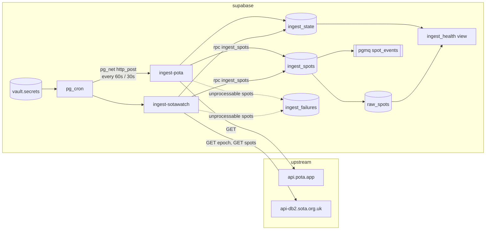
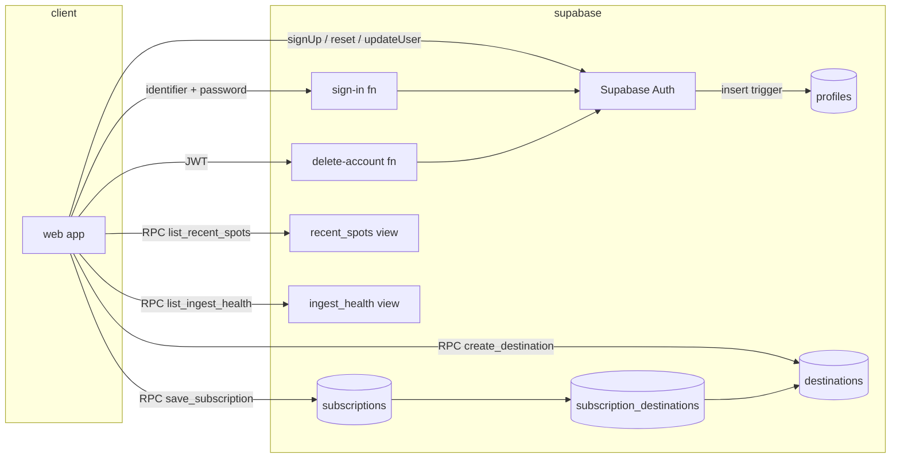
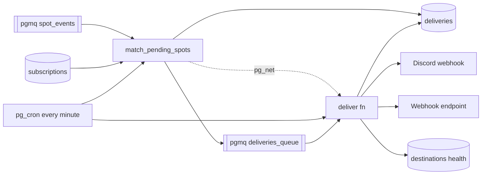
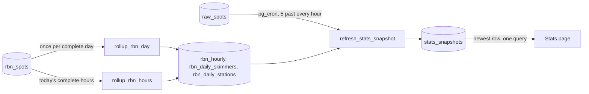
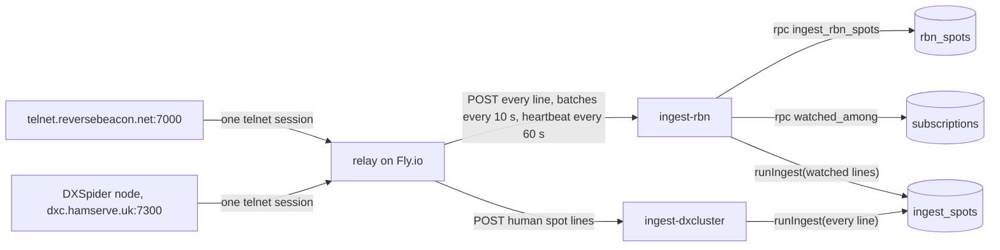
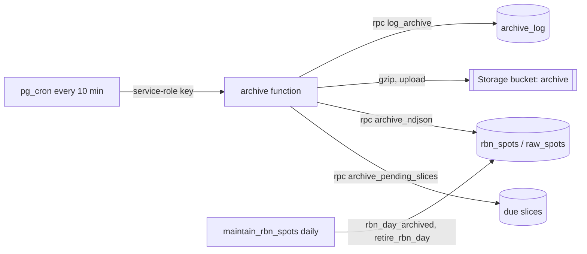
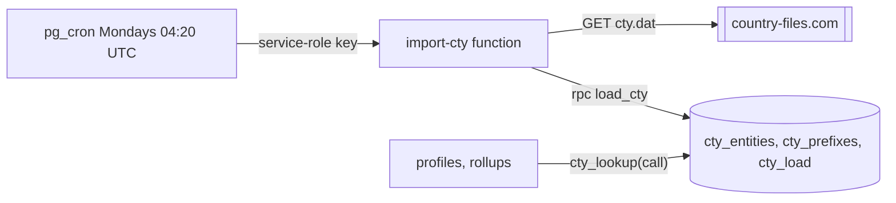
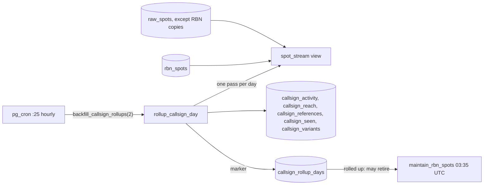
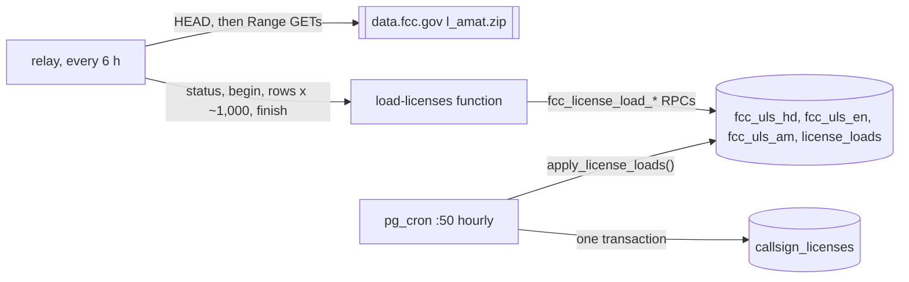
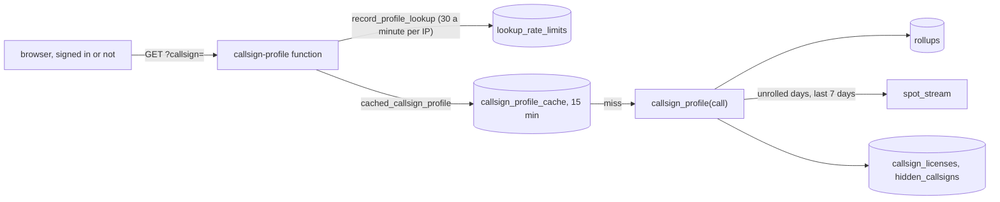

# Architecture (Phase 1)

## Flow

Both Edge Functions share one orchestrator (`supabase/functions/_shared/ingest.ts`) and differ
only in their source adapter (`pota.ts`, `sotawatch.ts`). A run:

1. SOTAwatch only: fetch the epoch token and compare with `ingest_state.last_epoch`. Unchanged
   means nothing new; record the run and return.
2. Fetch the feed with a `LongLines/0.1 (+<project url>)` User-Agent and a 10 s timeout.
3. Normalize each spot. Spots older than five minutes, test spots, and non-NORMAL SOTAwatch spots
   are skipped and counted. A spot that cannot be normalized (missing callsign, bad frequency) is
   collected for `ingest_failures`; it never aborts the run.
4. Call `ingest_spots(jsonb)` once with the whole batch.
5. Write the dead letters, then `record_ingest_success`. Any failure outside per-spot handling
   calls `record_ingest_failure` and returns a 500 so it shows up in function logs.

The function response body is the run summary (`fetched`, `inserted`, `skipped`, `failed`).

## Why the schema looks like this

`raw_spots` is a raw firehose: one row per source observation, no cross-source dedup. A station
spotted by both POTA and SOTAwatch is two rows. Downstream consumers decide what "the same spot"
means for their purpose; collapsing early would throw away information they may need.

Common fields are normalized (uppercase callsigns, kHz frequencies, lowercase modes, derived
`band` and `mode_family`) so consumers do not re-implement each source's quirks. Source-specific fields keep their
own nullable columns rather than a generic JSON blob, and `raw_payload` keeps the original record
for debugging and replay.

All timestamps are `timestamptz`. POTA sends spot times without an offset; they are UTC and the
normalizer appends `Z` before parsing.

## How dedup works

Each spot is hashed (sha256) over the upstream fields that can change after publication, in a
fixed order:

- POTA: `spotTime, activator, reference, frequency, mode, comments`
- SOTAwatch: `timeStamp, activatorCallsign, summitCode, frequency, mode, comments`
- RBN: `spot_time, spotter, callsign, frequency, mode, snr, speed, type`
- DX Cluster: `spot_time, spotter, callsign, frequency, comment`

The unique constraint `(source, source_spot_id, content_hash)` plus `INSERT ... ON CONFLICT DO
NOTHING RETURNING` does the rest: re-fetching an unchanged spot inserts nothing, and an edited
spot (new hash) lands as a new row. No existence check is needed before inserting, and the
RETURNING rows are exactly the new ones.

## Why insert and enqueue are one RPC

supabase-js cannot call `pgmq` directly: the schema is not exposed through PostgREST, and the
`pgmq_public` wrappers only exist when toggled on in the dashboard. `public.ingest_spots` wraps
the insert and `pgmq.send_batch` in one transaction, so a spot can never be stored without its
queue message, and the function makes one round trip for the whole batch.

## Why the queue is primed with no consumer

`spot_events` carries `{"spot_id", "source"}` for every new row. Nothing reads it in Phase 1.
Priming it now means the ingest path is already producing the contract later phases will consume,
and `pgmq.metrics('spot_events')` doubles as a check that the insert path is live.

## Why Vault for the cron credentials

The cron jobs call the functions over HTTP with the service-role key. The URL and key live in
Supabase Vault (`vault.decrypted_secrets`), encrypted at rest, created once by
`scripts/setup-db-settings.sql`. Migrations never contain them.

## Scheduling

pg_cron on Supabase accepts `"30 seconds"` as a schedule, so SOTAwatch is a single sub-minute
job. POTA runs on the standard `* * * * *`.

## Access

There is no RLS and no user-facing API in Phase 1. The tables, view and RPCs have their default
PostgREST grants revoked from `anon` and `authenticated`, so only the service role (and the
`postgres` user in Studio) can read or write them.

# Phase 2: accounts, destinations, subscriptions

## Accounts

Supabase Auth owns credentials. `profiles` holds the callsign, name and display
preferences and is created by a trigger on `auth.users` from the sign-up
metadata; a bad or taken callsign makes the trigger raise, so the sign-up
fails instead of leaving a user without a profile. `callsign_available()` is
the only anonymous RPC and reveals nothing but a boolean.

Signing in with a callsign goes through the `sign-in` Edge Function. It resolves
the callsign to an email with a service-role-only SQL function, calls
`signInWithPassword` server side, and returns the session tokens. The error
message is the same for an unknown identifier and a wrong password, unknown
identifiers still pay for a password check, and attempts are logged in
`sign_in_attempts` so the eleventh attempt per identifier in fifteen minutes is
refused.

## Destinations

A Discord webhook URL is a credential. `destinations.url` and
`destinations.signing_secret` are omitted from the column grant, so no client
query can read them; `create_destination()` validates the URL, stores the
masked `url_display`, and returns the signing secret exactly once.
`rotate_signing_secret()` issues a replacement.

URL rules, enforced in SQL and repeated by the delivery worker: https only;
Discord hosts must be `discord.com` or `discordapp.com` with an
`/api/webhooks/` path; webhook hosts may not be `localhost` or an IP literal in
a private, loopback, link-local, CGNAT, unspecified or IPv4-mapped range.

## Subscriptions

`save_subscription(jsonb)` writes the subscription and replaces its destination
links in one transaction and refuses destinations the caller does not own.
`subscription_destinations.destination_id` is `on delete restrict`, which is
what makes a destination in use undeletable. Filters are arrays where empty
means "any"; modes are stored lowercase and callsigns uppercase.

A callsign filter value matches a spot whose callsign is that value or whose base callsign is
(`base_callsign()`, below): `KK4PWJ` catches `KK4PWJ/P` and `W4/KK4PWJ`, while `KK4PWJ/P` catches
only `/P`. `raw_spots.base_callsign` is a stored generated column with its own index. The rule is
`callsign_matches()` (and `source_matches()` for sources), shared by `spot_matches` and the RBN
watchlist `watched_among`, so the two cannot drift apart.

A mode filter value matches either `raw_spots.mode` or `raw_spots.mode_family` (`cw`, `phone`,
`digital`). The family is derived at ingest by `supabase/functions/_shared/modes.ts`, the only
place that decides what a mode string means; SQL just compares strings. This exists because
SOTAwatch's spot form offers a single `DATA` label for every digital mode, so a filter on `ft8`
alone would never see a SOTA digital activation; `digital` catches both. When upstream sends a
blank or generic digital mode and the comment names a specific one ("FT8 QRP"), the specific
mode is stored, the same way the RBNHole spotter is read from the comment.

## Deleting an account

`delete-account` removes the `auth.users` row and everything cascades. Because
`subscription_destinations.destination_id` is `on delete restrict`, a
`before delete` trigger on `auth.users` first deletes the user's subscriptions
so the restrict rule, which exists to protect destinations still in use, does
not block the cascade.

## What clients can read

- `recent_spots`: the last 24 hours of `raw_spots` without `raw_payload`, read one source at a
  time through the `list_recent_spots(p_source, max_rows)` RPC (the table itself stays
  unreadable). For `rbn` the RPC reads `rbn_spots` instead, the whole feed in the same shape.
- `ingest_health`: read through the `list_ingest_health()` RPC so the Sources page can show it.
  RBN's spot counts come from `rbn_spots`.
- Both views are invoker views that clients cannot select directly; the security definer RPCs
  are the client path. Supabase's security linter flags definer views in an exposed schema, so
  don't turn either back into one.
- Their own `profiles`, `destinations` (safe columns), `subscriptions` and
  links, through RLS.
- `stats_snapshots`: hourly jsonb summaries of the last 7 complete UTC days, written only by
  cron (`refresh_stats_snapshot`). Anyone can read every row, signed in or not: the Stats page
  is public and the payload is aggregated from already-public spot feeds.

`deliveries`, `subscription_quiet` and `sign_in_attempts` are service-role only.

# Phase 2: matching and delivery

## Matcher

`match_pending_spots()` is a Postgres function because matching is a join:
one batch of `spot_events` against every enabled subscription through
`spot_matches(subscription, spot)`, the single predicate the preview uses too.
In one transaction it reads up to 500 events (60 s visibility), applies each
subscription's quiet window (`subscription_quiet` remembers the last send per
callsign; within a batch only the earliest spot per callsign is eligible),
inserts one `deliveries` row per (destination, spot) with `on conflict do
nothing` so two subscriptions sharing a destination deliver once, queues the
new delivery ids, archives the events, and pokes the `deliver` function over
pg_net when it created anything. It runs after every successful ingest and on
a one-minute cron as a safety net.

## Delivery worker

`deliver` claims up to 200 messages through `claim_deliveries()` (which joins
in the spot and the destination, secrets included, and archives orphans),
drops anything older than 24 hours, groups by destination, skips paused
destinations, and sends: Discord as embeds, ten per message and at most 30
messages per webhook per run, honoring `429 retry_after`; webhooks as signed
JSON, fifty spots per request, 10 s timeout. Every outcome goes back through an
RPC so the delivery rows, the queue messages and the destination's health
change together: `mark_deliveries_sent`, `mark_deliveries_failed` (backoff via
`pgmq.set_vt`, five in a row marks the destination failing), `delay_deliveries`
(rate limited, not a failure) and `mark_deliveries_dropped`.

Outbound URL safety is checked twice: in SQL when the destination is created
and in the worker before each request, which also resolves the hostname and
refuses private addresses so a DNS change after creation cannot turn a
webhook into an internal request. Redirects are never followed, and if the
runtime cannot resolve DNS the worker refuses to send rather than guess. What
remains is the window between resolving and connecting (classic rebinding),
which `fetch` cannot close without a custom dialer; the DNS check, the private
range refusal and the 10 s timeout keep that window small.

`send-test` reuses the same formatting and sending code for one labeled
sample spot.

# Phase 3: stats snapshot

The Stats page is a fixed dashboard of the seven most recent complete UTC days: midnight UTC seven
days ago up to, but not including, midnight UTC today, filtered on `spot_time`. The one exception
is "Spots processed per hour", which is hourly and so ends at the last complete UTC hour: the 168
hours before the refresh. Nothing on the page is adjustable, so the whole page is one precomputed
JSON document.

## Why a snapshot table

The payload is a dozen aggregates over a week of spots (totals, per-day, per-hour and per-band counts, a
per-state choropleth, mode shares, top activators and references, plus activation and chaser
counts beside every spot count). Computing it on every page view
would scan `raw_spots`, which clients cannot read anyway. Instead `refresh_stats_snapshot()`, a
security-definer plpgsql function, builds the payload in one `insert … with … select` and runs
from pg_cron at five past every hour. The web app selects the newest row by `generated_at`, caches
it for the browser session and never polls. The table keeps the 48 most recent rows (two days); the
refresh prunes older ones.

## Counting rules

- Only `pota` and `sotawatch` rows count toward the activity figures; RBN rows in `raw_spots`
  are copies of watched stations' `rbn_spots` rows and count nowhere. Every such row is one spot. A station spotted by both sources counts twice; callsigns are
  counted exactly as stored (`/P` and the like are kept). A spot is one report, not a contact: a
  busy activation is re-spotted many times, so spot counts run far ahead of operating activity.
- An activation is one distinct (callsign, reference, UTC day), per program. It is an estimate in
  both directions, not a floor on the programs' own numbers: unspotted activations are missing,
  while a callsign stored two ways (`KK4PWJ` and `KK4PWJ/P`) at one park on one day, or an attempt
  that ends short of the QSO minimum, adds one. The totals and both top-8 tables carry it next to
  the spot count.
- A chaser is a distinct spotter callsign, excluding null spotters and self-spots. A self-spot is
  one where spotter and activator share a base callsign: the call with known suffixes (`P`, `M`,
  `MM`, `AM`, `QRP`, `R`, a single digit) dropped, then the longest `/`-separated part, preferring
  a callsign-shaped part on a tie (`base_callsign()`; `is_self_spot()` is the one definition): `SQ1GPR` or `SQ1GPR/M` spotting
  `SQ1GPR/P`, `EA2/G4OBK` spotting itself, `G4OBK/P` spotting `W4/G4OBK`. An RBNHole spot whose
  comment names no skimmer has a null spotter. Skimmers named by RBNHole count as chasers.
- POTA state counts come from `pota_location`, a comma-separated list such as `US-NC,US-VA`; a park
  spanning two states counts once in each. Non-US entries and territories are ignored and all 51
  codes (50 states and DC) are always present, zero-filled.
- SOTA associations are the part of `sota_summit_ref` before the `/`.
- Bands use a fixed order (`160m` through `2m`); other bands are excluded from the band charts only.
- Modes collapse to CW, SSB (`ssb`, `usb`, `lsb`), FT8/FT4, FM and Other (including null) as
  integer percentages that sum to exactly 100; the rounding remainder goes to the largest bucket.
- Window arithmetic is done on `now() at time zone 'utc'` so a session time zone with DST cannot
  shift the window by an hour.
- `hourly` feeds "Spots processed per hour": the 168 complete UTC hours before the refresh (not
  the day window), zero-filled, each with the POTA and SOTAwatch `raw_spots` rows and the
  `rbn_spots` rows whose `spot_time` falls in that hour. The page plots their sum; the "Peak hour"
  tile figure comes from the same series.
  `daily[].rbn` is the RBN count per day.

## RBN figures

`rbn` holds the week's RBN spots, distinct skimmers, spots per band (the same fixed order as the
POTA and SOTA bands, so the three charts share an axis; other bands count in spots only) and
the eight most heard stations with how many distinct skimmers heard each. `rbn_spots` takes about 1.5 million rows a day, so the hourly
refresh never aggregates it. `rollup_rbn_day(day)` scans one day once, with grouping sets, into
three small tables: `rbn_hourly` (24 rows a day, zeros included), `rbn_daily_skimmers` (per
skimmer and band) and `rbn_daily_stations` (per callsign). Weekly distinct counts come from the
per-day rows, so they are exact. Skimmers per station cannot be summed from days, so they are
counted from `rbn_spots` (through `rbn_spots_callsign_time_idx`) for the eight stations only and
kept in `rbn_top_stations` until a rollup changes or the window moves. A full day's rollup takes
about 2.5 s; the refresh itself stays well under a second.

The hourly series also needs RBN counts for today's complete hours, which no day rollup covers
yet. `rollup_rbn_hours(from, to)` counts a range of hours into `rbn_hourly` through the
`spot_time`-led unique key of `rbn_spots` (two hours are about 30,000 rows, 25 ms on hosted), and
`rbn_rollup_hours` records when each hour was counted. When the day ends, `rollup_rbn_day`
replaces its 24 rows and the hour markers are deleted.

The refresh rolls up every window day missing from `rbn_rollup_days`, and once more any day rolled
up within an hour of its end, since the relay can hold up to about 50 minutes of lines while
`ingest-rbn` is unreachable. Today's hours follow the same rule through `rbn_rollup_hours`. Rows arriving later than that are not counted. Rollups older than
the window are deleted; the archive keeps every spot.

The payload's TypeScript shape is `StatsPayload` in `web/src/stats/types.ts`; the pgTAP suite
`supabase/tests/stats_snapshot.test.sql` pins both the shape and the numbers.

# Streaming sources: the relay

The Reverse Beacon Network only offers a persistent telnet stream. Edge Functions cannot hold one,
and reconnecting every couple of minutes is not acceptable to RBN, so one small process outside
Supabase holds it: `relay/`, a Deno program on a single Fly.io machine (shared-cpu-1x, 256 MB; it
uses about 20 MB). Issue #13 records the options that were weighed first.

- **Push instead of pull.** `ingest-rbn` runs `runRbnPush` (`_shared/rbn_push.ts`) on each
  batch: it stores every line, then passes the watched ones to the same orchestrator as the pulled
  sources, with `rbnAdapter(body)` wrapping them so `fetchSpots()` returns them; `runIngest` is
  unchanged. The relay never sees a Supabase key: it sends a shared secret in `x-relay-secret`,
  and the function (with `verify_jwt = false`) compares it with `LONGLINES_RELAY_SECRET` in
  constant time. Only `POST` is accepted.
- **Everything is stored; watched callsigns are alerted.** The relay forwards every spot line.
  `ingest-rbn` writes each batch to `rbn_spots` (one RPC, `ingest_rbn_spots`), a table
  partitioned by UTC day that keeps seven days in the database; `maintain_rbn_spots()` drops a day
  once every 10-minute slice is archived with a matching count and the callsign rollups have
  recorded it or it is older than 14 days (see "The spot archive"). Only lines whose station `watched_among('rbn', stations)`
  returns (named by an enabled subscription whose sources are empty or include `rbn`, exactly or by
  base call, the matcher's rule) continue through `runIngest` into `raw_spots` and the matcher, so
  alerting sees a few hundred RBN rows a day.
- **Partitions.** `maintain_rbn_spots()` runs daily at 03:35 UTC and keeps partitions for today and
  three days ahead. Partitions live in the `partitions` schema, which PostgREST does not expose and
  the generated web types do not include. Rows for a day without a partition land in
  `partitions.rbn_spots_default`; `create_rbn_spots_partition` moves them in when it creates that
  day.
- **One parser.** The relay drops non-spot lines with `parseRbnLine` from `_shared/rbn.ts`, the
  same function `ingest-rbn` uses, so the relay and the stored spot cannot disagree about what a
  line is.
- **Dates and ids.** A telnet line has only `HHMMZ`. The adapter takes the instant with that time
  of day closest to the relay's `received_at`. `source_spot_id` is
  `spot_time|spotter|callsign|frequency`; the hash field order is `spot_time, spotter, callsign,
  frequency, mode, snr, speed, type` and must not change.
- **Matching guard.** `spot_matches` lets an RBN spot match only subscriptions that name
  callsigns, so "any source, 20m CW" does not receive other people's watchlist hits. A trigger
  rejects a subscription limited to RBN with no callsigns, since it could never match.
- **Politeness and health.** One connection per feed, reconnect backoff from 30 s (the floor) to
  15 minutes with jitter, reset after a session that lasted five minutes. No data for five minutes
  counts as a dead connection. The relay pushes at least once a minute, even an empty batch, so
  `ingest_state.last_success_at` shows whether it is alive; the Sources page treats RBN as delayed
  after three minutes without one. `:8080/healthz` reports per-feed status for `fly checks list`.
- **More feeds.** `relay/feeds.ts` is a list. A new telnet stream (RBN FT8 on 7001, say) is a new
  entry plus a source adapter and an `ingest-<source>` function built with `servePush`.
  `_shared/relay_lines.ts` holds what the pushed sources share: the request body and the `HHMMZ`
  dating.
- **Not only telnet.** The relay also runs the weekly FCC license load, because the file is too
  big for an Edge Function (see "Licenses (FCC)").

## DX Cluster

The second feed is a DXSpider node, by default G1FEF-2 (`dxc.hamserve.uk:7300`, overridable with
`DXCLUSTER_HOST`/`DXCLUSTER_PORT`), which allows read access without registration. The relay logs
in with `RELAY_LOGIN_CALL` and forwards every line `parseDxLine` (`_shared/dxcluster.ts`) accepts.

- **Straight to raw_spots.** Human spots are a few hundred an hour (a capture on 2026-10-12 saw
  about seven a minute), so there is no firehose table: `ingest-dxcluster` runs `runIngest` over
  the whole batch, like a pulled source, and the archive takes `dxcluster` from `raw_spots` in
  hourly slices.
- **Opt-in matching.** `source_matches`, the sources rule `spot_matches` uses, lets a DX Cluster
  spot match only subscriptions whose `sources` lists `dxcluster`. An empty sources list keeps
  meaning what it meant before the source existed, so existing "any source, 20m" subscriptions
  are not flooded with DX spots.
- **Mode.** A cluster line has no mode field. `resolveDxMode` (`_shared/modes.ts`) takes a mode
  named in the comment (CW, SSB, FT8, ...; FM and AM are not read from comments, where "fm" usually
  means "from"), else the band plan: FT8/FT4 dial windows, then the IARU CW and phone segments.
  Elsewhere, such as 60m, the digital sub-bands and VHF, the mode stays null. USB and LSB are stored
  as `ssb`.
- **Not spots.** Skimmer lines (a `-#` spotter, or an RBN-style `[mode] NN dB NN WPM` comment)
  that a node relays are dropped; RBN covers them. So are `WWV`, `WCY` and `To ALL` broadcasts.
  DXSpider ends each spot line with two BEL characters, which the parser strips. The time is the
  last `HHMMZ` on the line; a locator, state or zones a node appends after it are ignored.
- **Relay image.** The Dockerfile's `--allow-env` names every variable the relay reads, including
  `DXCLUSTER_HOST`/`DXCLUSTER_PORT`; a test fails when the relay reads one the image does not allow.
- **Ids.** As with RBN, the line has only `HHMMZ`; `source_spot_id` is
  `spot_time|spotter|callsign|frequency`, and the hash covers the comment too, so a re-spot with a
  new comment in the same minute is stored.
- **Quiet hours.** Human spots can pause for minutes, so this feed reconnects after 15 minutes
  without data (RBN: 5) and `/healthz` marks it unhealthy after 20 (RBN: 10).

# The spot archive

Every spot of every source is kept for analytics as gzipped NDJSON in a private Storage bucket,
`archive` (spec `docs/superpowers/specs/2026-10-11-rbn-firehose-archive-design.md` and its
measurement amendment).

- **Slices.** RBN is archived in 10-minute slices, POTA, SOTAwatch and DX Cluster hourly. The length lives only
  in `archive_slice_minutes(source)`; slices are aligned with `date_bin` and half-open
  (`[start, end)`). Objects are `<source>/YYYY/MM/DD/HHMM.ndjson.gz`.
- **Postgres does the heavy lifting.** `archive_pending_slices` returns the slices that ended two
  hours ago and are not logged, starting at midnight UTC of the first spot's day; `archive_ndjson` builds a slice's NDJSON with `to_json` and
  `string_agg`. The function only gzips and uploads, which measured at about 0.3 s of CPU for a full
  RBN hour against the 2 s limit.
- **Runs.** pg_cron calls `archive` every 10 minutes with the service-role key (Vault), like the
  ingest jobs. A run takes POTA, then SOTAwatch, then DX Cluster, then RBN, oldest first, and
  starts no new slice once it has archived 60,000 rows, so a backlog clears about six times faster
  than real time without risking the CPU limit.
- **Logged only when stored.** A slice gets its `archive_log` row (count, bytes, path) only after
  the upload succeeds; a failure leaves it pending for the next run. Empty slices are logged with
  `row_count = 0` and no object, so a gap in `archive_log` always means "not archived".
- **Lines.** RBN: `spot_time, received_at, spotter, callsign, frequency_khz, band, mode,
  mode_family, snr, speed, speed_unit, spot_type, line`. POTA, SOTAwatch and DX Cluster: every
  `raw_spots` column except `id`, including the upstream `raw_payload`. Watched RBN rows in
  `raw_spots` are not archived from there.
- **Retention.** `maintain_rbn_spots()` (03:35 UTC, off the archive's 10-minute grid) retires RBN
  days older than seven that `callsign_rollup_days` records (callsign profiles keep per-station
  totals from every day), and any archived day older than 14 so a missing rollup cannot stop
  retention: `rbn_day_archived` checks every eligible day first (it also clears mismatched log
  rows), then `retire_rbn_day`
  drops the archived ones last, so the exclusive lock a partition drop takes is held only briefly
  and gives up after 5 s. The day's partition and any default-partition rows go only when all
  144 slices are logged with the database's count (`rbn_day_slices`). A mismatched slice loses its
  log row, so the next run re-archives it and the day is retried the next night. `raw_spots` is
  never pruned.

# Countries (cty.dat)

Callsign profiles say which countries and continents a station is heard from, by the spotter's
call. The table behind that is AD1C's cty.dat, the country file loggers use
(spec `docs/superpowers/specs/2026-10-12-callsign-lookup-design.md`).

- **Import.** `import-cty` downloads the file weekly, `_shared/cty.ts` parses it, and `load_cty`
  replaces all three tables in one transaction. A reader sees the old set or the new one. A file
  that does not parse, or has fewer than 300 entities, is refused, and the loaded set stays.
  `cty_load` records the file's version (`=VERyyyymmdd`) and the counts.
- **DXCC, not WAE.** Entities whose primary prefix starts with `*` (Sicily, European Turkey,
  Shetland, ...) are DARC WAE entities. They are not loaded, so their calls fall through to the
  DXCC country (`IT9` to Italy).
- **Lookup.** `cty_lookup(call)` is the only place a call becomes an entity, continent and zones.
  It drops an SSID or skimmer marker (`K3PA-1`, `DK9IP-#`). The location is one of the call's
  `/` parts. Call-area digits are ignored, and so are `/P`, `/M`, `/QRP`, `/QRPP`, `/R`, `/A`, `/B`
  and `/LH` after the first part; written first they are prefixes (`M/DL1ABC` is England). Of the
  rest, a part that is itself a cty.dat prefix wins (`KA1A/VP2E`, `K1A/KH6`), then a part ending
  in a digit (`W4/G4OBK`, `KK4PWJ/VE3`), then the shorter one. It does not use
  `base_callsign()`, which breaks length ties by position. An exact `=` entry for the call or the
  location wins over the longest matching prefix. `/MM` and `/AM` have no country.
- **Access.** The tables are service-role only, like the other internal tables. The rollups read
  them through `cty_lookup`; profiles will read them through definer RPCs.

# Callsign rollups

Callsign profiles cover every day since Long Lines started, but `rbn_spots` keeps only seven. The
rollups keep per-station counts and breakdowns forever, never per-spotter rows (spec
`docs/superpowers/specs/2026-10-12-callsign-lookup-design.md`).

- **`spot_stream`.** One row shape for every source: `source`, `spot_time`, `callsign`,
  `base_callsign`, `spotter`, `spotter_base`, `frequency_khz`, `band`, `mode`, `mode_bucket`,
  `snr`, `program`, `reference`, `reference_name`, `reference_location`. It is `raw_spots` without
  its RBN rows (copies) plus `rbn_spots`. A source that writes `raw_spots` appears with no change;
  a new firehose table needs one `union all` arm. The base columns are computed per row for
  `rbn_spots`, so a query over many RBN rows groups by `callsign` first. Service-role only.
- **`mode_bucket(mode, mode_family)`.** The Stats chart buckets (CW, SSB, FT8/FT4, FM, Other).
  CW follows `mode_family`, so SQL still never derives a family.
- **Tables.** `callsign_activity` (period, base, role, source, band, mode bucket: spots and
  spots per UTC hour), `callsign_reach` (period, base, source, spotter country and continent),
  `callsign_references` (base, program, reference: days, spots, first and last day, latest name),
  `callsign_seen` (base: first and last spot, the last one's frequency and mode, days on the air)
  and `callsign_variants` (base, spelling: spots, last day). Role `heard` is the station spotted;
  role `spotter` is the station spotting others. Self-spots count as heard but not as spotter
  or reach. Countries come from `cty_lookup`, once per distinct spotter.
- **Exactly once.** `rollup_callsign_day(day)` inserts the day's `callsign_rollup_days` marker
  first and does nothing when it is already there: references, seen and variants are running
  totals and would double. A day is rolled up from two hours after it ends
  (`last_rollup_day()`); a spot that arrives after that is not counted.
- **Whole days or none.** A day is refused, and retried on the next run, while no cty.dat is
  loaded (its reach would stay empty) or once its RBN rows were archived and retired (retention
  stops waiting at 14 days). `rollup_callsign_day(day, true)` rolls up such a day without RBN when
  an operator accepts the gap.
- **One pass.** A day is grouped once by call, spotter, band, mode, hour and reference; base calls
  and countries are resolved per distinct call afterwards. A synthetic 1.5M-row RBN day takes about
  13 s locally.
- **Hourly.** The `rollup-callsign-days` cron job runs `backfill_callsign_rollups(2)` at 25 past
  every hour: at most two days without a marker, oldest first, each in its own subtransaction,
  then it folds day rows older than 35 days into month rows (`compact_callsign_rollups`). A
  failed day is a warning, does not count toward the two, and is retried next hour. Yesterday is
  rolled up at 02:25 UTC, ahead of RBN retention at 03:35. The job is separate from
  `maintain_rbn_spots()` on purpose: a slow or cancelled rollup never holds that job's partition
  locks or undoes its retention, and retention still retires an RBN day 14 days old without its
  rollup.

# Licenses (FCC)

Profiles show a station's license (spec `docs/superpowers/specs/2026-10-12-callsign-lookup-design.md`).
`callsign_licenses` holds one row per callsign with an `authority` column, so other countries'
registries can load into it later; FCC is the only loader for now.

- **Where it runs.** The FCC publishes the full amateur file, `l_amat.zip`, every Sunday: about
  200 MB, of which the three files used are 160 MB compressed and 525 MB inflated, about 1.7M
  records each. An Edge Function cannot stream that within its limits, so the relay does
  (`relay/licenses.ts`). Every six hours it HEADs the file. A relay whose functions URL is local
  does not load licenses unless `RELAY_LICENSES` names a file. When the `Last-Modified` is not already
  ready or applied (`fcc_license_load_status`), it loads it; a load that did not finish is retried
  after twelve hours, so a load that keeps failing downloads the file twice a day at most.
- **Streaming.** `relay/zip.ts` reads the zip's central directory from its tail, then fetches only
  `HD.dat`, `EN.dat` and `AM.dat` with Range requests and inflates them with
  `DecompressionStream`. Every range carries `If-Range` with the `Last-Modified` HEAD saw, so a
  file the FCC replaces mid-load comes back as a 200, which is refused, rather than as a mix of
  two weeks' bytes. Memory stays flat (a full run against the real file parsed all three in
  13 s before network time and stayed under the relay's 160 MB heap); an inflated size that differs from the directory's is
  an error, which catches a truncated download.
- **Parsing.** `_shared/uls.ts` turns records into rows: HD gives call, status and dates, EN the
  licensee's name and state, AM the operator class. Codes become labels (`Amateur Extra`,
  `Active`). A field with a line break in it is joined back onto its record. Nothing else leaves
  the parser: no street address, city, ZIP, PO box, phone, email or FRN. The staging tables have no
  columns for them either, and `jsonb_to_recordset` drops any such key.
- **Staging.** The files are not sorted by system identifier, so the relay cannot join them in
  memory. It pushes 5,000 rows per request to `load-licenses` (relay secret, `verify_jwt =
  false`), which stages them in unlogged tables keyed by system identifier. A retried batch is
  skipped by `on conflict do nothing`. Each `rows` call answers the file's running total, kept in
  `license_loads.counts` in the same transaction, so a batch retried after a lost reply is not
  counted twice or lost. `finish` compares those totals with the tables and marks the load
  `ready`. Fewer than 500,000 records in any file is refused first. When the relay gives up (a
  short file, a batch that keeps failing, a shutdown) it calls `abandon`, which fails the load
  with the reason and empties staging at once.
- **The swap.** Replacing about 1.5M rows takes longer than the API's 8 s statement timeout, so the
  swap is not an RPC. `apply_license_loads()` runs from pg_cron at :50 every hour. It is a no-op
  unless a load is ready. It deletes the FCC rows and inserts the joined staging set in one
  transaction, so a reader sees the old set or the new one. When a call has several records (a
  call reissued after it lapsed), the active one wins, then the latest grant. If staging no longer
  matches the recorded counts (unlogged tables are emptied by a crash) or the insert fails, the
  load is marked `failed` and the old set stays.
- **Access.** Service-role only, like `license_loads`, the staging tables and the RPCs. The data
  is public FCC data, but a direct read would show the license of a call in `hidden_callsigns`,
  so clients get licenses only through `callsign_profile()` (the `callsign-profile` function).
  `20261012000050` granted `select` to `anon` and `authenticated`; `20261012000070` revokes it.

# Callsign profiles

A profile is everything Long Lines has heard from one station, for a public page (spec
`docs/superpowers/specs/2026-10-12-callsign-lookup-design.md`).

- **One RPC.** `callsign_profile(call)` returns the whole page as jsonb. Its shape is
  `CallsignProfile` in `web/src/profile/types.ts`, pinned by
  `supabase/tests/callsign_profile.test.sql`. It is security definer and not granted to clients.
  SQL reduces the call to its base (`KK4PWJ/P` is `KK4PWJ`'s profile); TypeScript only checks
  that the input looks like a callsign.
- **Rollups plus the live edge.** All-time figures come from the rollups. Days of the last 14
  without a `callsign_rollup_days` marker (today, yesterday until 02:25 UTC, a failed day) are
  read from `spot_stream` and added in, with the same rules: self-spots count as heard but not in
  reach. The test checks that a day reads the same live as rolled up. "Heard by" (top 10) and
  "Recent spots" (newest 25) always read the last 7 days live. Hunting comes from the rollups
  only, since reading it live would need a spotter index on every source.
- **The `rbn_spots` index.** `(base_callsign(callsign), spot_time)`, built per partition and
  attached to a parent index so the build blocks inserts only for today's partition. It stores
  `base_callsign()` output, so a migration that changes that function must reindex it.
- **One read of a station.** The RPC reads `spot_stream` once, through `raw_spots`'
  `(base_callsign, spot_time)` index and `rbn_spots`' `(base_callsign(callsign), spot_time)`
  expression index, and groups spotters before resolving their base calls and countries. It reads
  the unrolled days in full, the week grouped by spotter and the week's newest 25, never the whole
  week's rows. Against 1.5M-row RBN days locally, a profile builds in about 70 ms for a station
  with 5,000 RBN spots a day (about 220 ms right after a restart) and about 200 ms for one with
  20,000.
- **Not heard and hidden.** `heard` is null for a station never spotted that never spotted
  anyone. A call in `hidden_callsigns` (operator-managed, base calls) gets that shape with no
  license, and skips the cache, so hiding takes effect at once.
- **The function.** `callsign-profile` (`_shared/handlers/callsign_profile.ts`) is public: `verify_jwt = false`,
  no caller check, so it must never import `isServiceRole` (a test fails if any
  `verify_jwt = false` function reaches it). It returns 400 for input that cannot be a callsign
  (TypeScript checks the shape; SQL returns null when the input has no base call, like `P/1`),
  counts each lookup against a one-minute window per client and returns 429 with "Too many
  lookups. Try again in a minute." past 30. The client is the address from a header the edge proxy
  sets (`LONGLINES_CLIENT_IP_HEADER`, `cf-connecting-ip` by default; the last entry if it holds a
  list), else the last `x-forwarded-for` entry, never the first, which the client writes. A value
  that is not an IP address counts as missing, and the first fallback in an isolate logs a warning.
  An IPv6 client counts by its /64, since one host usually holds the whole prefix. It is stored as an
  HMAC keyed with the service-role key (imported once per isolate), so the table cannot be reversed
  by hashing every IPv4 address. Profiles are
  cached in the database for 15 minutes and sent with `Cache-Control: public, max-age=300`.
  `prune_callsign_lookups()` clears finished windows and expired entries hourly at :15.
