# Architecture (Phase 1)

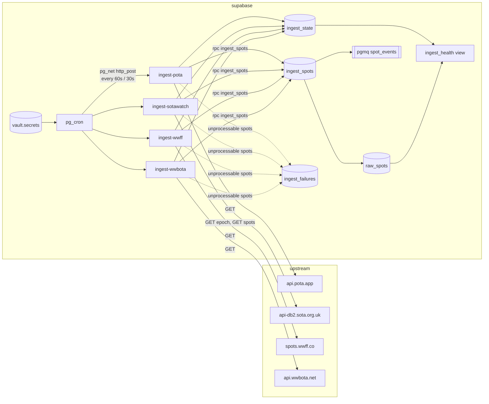

## Flow

The pulled sources' Edge Functions share one orchestrator (`supabase/functions/_shared/ingest.ts`)
and differ only in their source adapter (`pota.ts`, `sotawatch.ts`, `wwff.ts`, `wwbota.ts`). A run:

1. SOTAwatch only: fetch the epoch token and compare with `ingest_state.last_epoch`. Unchanged
   means nothing new; record the run and return.
2. Fetch the feed with a `LongLines/0.1 (+<project url>)` User-Agent and a 10 s timeout.
3. Normalize each spot. Spots older than five minutes, test spots, and non-NORMAL SOTAwatch spots
   are skipped and counted. A spot that cannot be normalized (missing callsign, bad frequency) is
   collected for `ingest_failures`; it never aborts the run.
4. Call `ingest_spots(jsonb)` once with the whole batch.
5. Write the dead letters, then `record_ingest_success`. Any failure outside per-spot handling
   calls `record_ingest_failure` and returns a 500 so it shows up in function logs.

The function response body is the run summary (`fetched`, `inserted`, `skipped`, `failed`).

## Why the schema looks like this

`raw_spots` is a raw firehose: one row per source observation, no cross-source dedup. A station
spotted by both POTA and SOTAwatch is two rows. Downstream consumers decide what "the same spot"
means for their purpose; collapsing early would throw away information they may need.

Common fields are normalized (uppercase callsigns, kHz frequencies, lowercase modes, derived
`band` and `mode_family`) so consumers do not re-implement each source's quirks. APRS-IS spots
are the one exception with no frequency: `frequency_khz`, `band` and `mode` are null for them. Source-specific fields keep their
own nullable columns rather than a generic JSON blob, and `raw_payload` keeps the original record
for debugging and replay.

All timestamps are `timestamptz`. POTA sends spot times without an offset; they are UTC and the
normalizer appends `Z` before parsing.

## How dedup works

Each spot is hashed (sha256) over the upstream fields that can change after publication, in a
fixed order:

- POTA: `spotTime, activator, reference, frequency, mode, comments`
- SOTAwatch: `timeStamp, activatorCallsign, summitCode, frequency, mode, comments`
- RBN: `spot_time, spotter, callsign, frequency, mode, snr, speed, type`
- DX Cluster: `spot_time, spotter, callsign, frequency, comment`
- WWFF: `spot_time, activator, reference, frequency_khz, mode, remarks`
- WWBOTA: `time, call, freq, mode, comment` (not `type`, which flips from Live to QRT after the fact)
- APRS-IS (watched stations only): `callsign, bucket`, the bucket being `received_at` floored to
  15 minutes, so a station makes at most one spot per window (see "APRS-IS")

The unique constraint `(source, source_spot_id, content_hash)` plus `INSERT ... ON CONFLICT DO
NOTHING RETURNING` does the rest: re-fetching an unchanged spot inserts nothing, and an edited
spot (new hash) lands as a new row. No existence check is needed before inserting, and the
RETURNING rows are exactly the new ones.

## Why insert and enqueue are one RPC

supabase-js cannot call `pgmq` directly: the schema is not exposed through PostgREST, and the
`pgmq_public` wrappers only exist when toggled on in the dashboard. `public.ingest_spots` wraps
the insert and `pgmq.send_batch` in one transaction, so a spot can never be stored without its
queue message, and the function makes one round trip for the whole batch.

## Why the queue is primed with no consumer

`spot_events` carries `{"spot_id", "source"}` for every new row. Nothing reads it in Phase 1.
Priming it now means the ingest path is already producing the contract later phases will consume,
and `pgmq.metrics('spot_events')` doubles as a check that the insert path is live.

## Why Vault for the cron credentials

The cron jobs call the functions over HTTP with the anon key as the bearer (to pass `verify_jwt`)
and a cron secret in `x-cron-secret`, which `isServiceRole` checks against `LONGLINES_CRON_SECRET`.
Never the service-role key: pg_net queues each request in `net.http_request_queue`, which every
database role can read (`20261029000500`; it falls back to the service-role key only until both new
secrets exist). The URL and secrets live in Supabase Vault (`vault.decrypted_secrets`), encrypted
at rest, created once by `scripts/setup-db-settings.sql`. Migrations never contain them.

## Scheduling

pg_cron on Supabase accepts `"30 seconds"` as a schedule, so SOTAwatch is a single sub-minute
job. POTA runs on the standard `* * * * *`, and so do WWFF (`ingest-wwff`), whose feed is served
with `max-age=60`, and WWBOTA (`ingest-wwbota`), whose feed holds the last hour.

## Access

There is no RLS and no user-facing API in Phase 1. The tables, view and RPCs have their default
PostgREST grants revoked from `anon` and `authenticated`, so only the service role (and the
`postgres` user in Studio) can read or write them.

# Phase 2: accounts, destinations, subscriptions

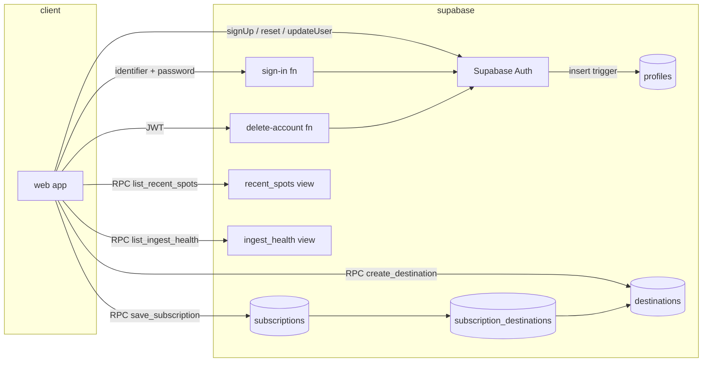

## Accounts

Supabase Auth owns credentials. `profiles` holds the callsign, name and display
preferences and is created by a trigger on `auth.users` from the sign-up
metadata; a bad callsign makes the trigger raise, so the sign-up fails instead
of leaving a user without a profile. Accounts may share a callsign
(`20261029000600`): a club account and its owner's own account can both hold
it. `profiles.callsign_since` records when the profile took its base call, and
only the longest holder may post logged contacts as it.

Signing in is by email only, through the `sign-in` Edge Function, since a
callsign no longer names one account; it refuses anything else before a lookup.
It calls `signInWithPassword` server side and returns the session tokens. The
error message is the same for an unknown email and a wrong password, and
attempts are logged in `sign_in_attempts`, keyed on the email, so the eleventh
attempt in fifteen minutes is refused. A failed sign-in answers no sooner than
300 ms after the request started.

## Destinations

A Discord webhook URL is a credential. `destinations.url` and
`destinations.signing_secret` are omitted from the column grant, so no client
query can read them; `create_destination()` validates the URL, stores the
masked `url_display`, and returns the signing secret exactly once.
`rotate_signing_secret()` issues a replacement.

URL rules, enforced in SQL and repeated by the delivery worker: https only;
Discord hosts must be `discord.com` or `discordapp.com` with an
`/api/webhooks/` path; webhook hosts may not be `localhost` or an IP literal in
a private, loopback, link-local, CGNAT, unspecified or IPv4-mapped range.

## Subscriptions

`save_subscription(jsonb)` writes the subscription and replaces its destination
links in one transaction and refuses destinations the caller does not own.
`subscription_destinations.destination_id` is `on delete restrict`, which is
what makes a destination in use undeletable. Filters are arrays where empty
means "any"; modes are stored lowercase and callsigns uppercase.

A callsign filter value matches a spot whose callsign is that value or whose base callsign is
(`base_callsign()`, below): `KK4PWJ` catches `KK4PWJ/P` and `W4/KK4PWJ`, while `KK4PWJ/P` catches
only `/P`. `raw_spots.base_callsign` is a stored generated column with its own index. The rule is
`callsign_matches()` (and `source_matches()` for sources), shared by `spot_matches` and the RBN
watchlist `watched_among`, so the two cannot drift apart. A subscription can also name callsign
groups (`group_ids`); the callsign filter is the union of the typed calls and the groups' members
(see "Callsign groups" below).

A mode filter value matches either `raw_spots.mode` or `raw_spots.mode_family` (`cw`, `phone`,
`digital`). The family is derived at ingest by `supabase/functions/_shared/modes.ts`, the only
place that decides what a mode string means; SQL just compares strings. This exists because
SOTAwatch's spot form offers a single `DATA` label for every digital mode, so a filter on `ft8`
alone would never see a SOTA digital activation; `digital` catches both. When upstream sends a
blank or generic digital mode and the comment names a specific one ("FT8 QRP"), the specific
mode is stored, the same way the RBNHole spotter is read from the comment.

## Deleting an account

`delete-account` removes the `auth.users` row and everything cascades. Because
`subscription_destinations.destination_id` is `on delete restrict`, a
`before delete` trigger on `auth.users` first deletes the user's subscriptions
so the restrict rule, which exists to protect destinations still in use, does
not block the cascade.

## What clients can read

- `recent_spots`: the last 24 hours of `raw_spots` without `raw_payload` (the WWFF and
  WWBOTA reference columns included), read one source at a
  time through the `list_recent_spots(p_source, max_rows)` RPC (the table itself stays
  unreadable). For `rbn` the RPC reads `rbn_spots` instead, the whole feed in the same shape.
  APRS-IS rows (watched beacons, see "APRS-IS") are left out.
- `ingest_health`: read through the `list_ingest_health()` RPC so the Sources page can show it.
  RBN's spot counts come from `rbn_spots`.
- Both views are invoker views that clients cannot select directly; the security definer RPCs
  are the client path. Supabase's security linter flags definer views in an exposed schema, so
  don't turn either back into one.
- Their own `profiles`, `destinations` (safe columns), `subscriptions` and
  links, `callsign_groups` and `callsign_group_members`, through RLS.
- `stats_snapshots`: hourly jsonb summaries of the last 7 complete UTC days, written only by
  cron (`refresh_stats_snapshot`). Anyone can read every row, signed in or not: the Stats page
  is public and the payload is aggregated from already-public spot feeds.

`deliveries`, `subscription_quiet` and `sign_in_attempts` are service-role only.

# Phase 2: matching and delivery

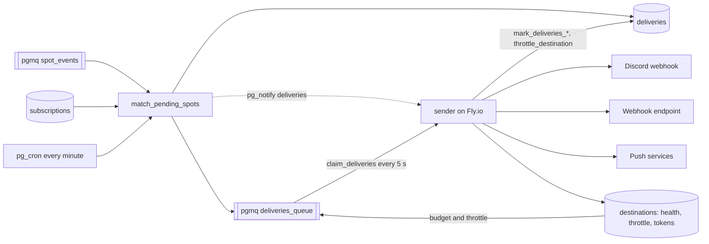

## Matcher

`match_pending_spots()` is a Postgres function because matching is a join:
one batch of `spot_events` against every enabled subscription with a destination through
`spot_matches(subscription, spot)`, the single predicate the preview uses too.
In one transaction it reads up to 500 events (60 s visibility), applies each
subscription's quiet window (`subscription_quiet` remembers the last send per
callsign; within a batch only the earliest spot per callsign is eligible),
inserts one `deliveries` row per (destination, spot) with `on conflict do
nothing` so two subscriptions sharing a destination deliver once, queues the
new delivery ids, archives the events, and sends `pg_notify('deliveries', '')`
when it created anything (the sender polls today and will listen on that
channel later; the matcher never calls a function over pg_net). It runs after
every successful ingest and on a one-minute cron as a safety net.

## Delivery: the sender

Outbound delivery is `sender/`, a Deno process on one Fly.io machine (app `longlines-sender`,
shared-cpu-1x, 256 MB), the counterpart of the inbound worker. Until 2026-10-15 it was a `deliver` Edge
Function, called by cron every minute and kicked over pg_net after every ingest run that created
deliveries: every run was an invocation, so delivery volume scaled the project's invocation
count, while a process that polls costs nothing per poll. That function, its cron job and its
own RPCs are gone (`20261015001400_sender_cleanup`). The design, with its decisions and
the Phase 2 plan, is `docs/superpowers/specs/2026-10-15-outbound-sender-design.md`.

- **The sender is dumb; policy lives in Postgres.** It connects as the `delivery_sender` role
  through the Supavisor pooler (session mode, TLS, two connections) and may execute exactly seven
  security-definer RPCs: `claim_deliveries`, `mark_deliveries_sent`, `mark_deliveries_failed`,
  `throttle_destination`, `delivery_queue_stats`, `prune_push_devices` and `record_push_results`.
  It has no table privileges, nothing on `pgmq` and no Supabase API key; `sender_role.test.sql`
  pins that list. Its loop (`_shared/delivery/run.ts`, `runDeliveryBatch`) claims, sends and
  reports. What to send, in what order, how much and when to give up are decided in SQL.
- **The claim is rate-aware and newest first.** `claim_deliveries(p_limit, p_vt)` first drops
  rows the user no longer wants (a disabled subscription, an unlinked or disabled destination),
  then expires pending rows older than `destination_max_age(type)` (push 15 minutes, everything
  else 24 hours) or, for a push destination, its own "drop if the device is offline for"
  (`push_destination_settings.ttl_seconds`), stamping `deliveries.dropped_at` and archiving their
  messages, so the oldest rows retire without ever being claimed. Then, per destination, it refills a token bucket kept on the
  `destinations` row (`claim_tokens`, `claim_tokens_at`; `destination_budget(type)` is the rate
  in spots per minute: Discord 300, push 3, webhooks 1000, burst equal to the rate except
  Discord's 100, of which one claim takes at most 50, `destination_claim_max`), ranks the
  destination's visible messages newest first, takes the ranks its tokens cover, and interleaves
  destinations by rank so every destination's newest spot goes before any destination's second.
  Paused and throttled destinations are left out, and so is a Discord destination holding for its
  batch window (`discord_destination_settings.batch_seconds` 10, 30 or 60): while its oldest
  visible row is younger than the window and fewer than ten are waiting, none of its rows are
  claimed, debited, delayed or dropped, so a trickle waits at most the window and ten go at once
  (see "Discord destinations" below). A webhook with a window (`webhook_destination_settings.batch_seconds`)
  is held the same way, released at `destination_batch_full('webhook')` (50) ready rows, and a
  webhook sending one request per spot takes at most `webhook_claim_max(0)` (5) spots a claim
  (see "Webhook destinations" below). A Discord destination is also paced by
  `destination_claim_interval('discord')` (10 seconds) on a schedule: each claim moves
  `claim_due_at` on by 10 seconds from where it was (from now when that is past), and the claim
  leaves the destination out until half an interval before it is due. The sender claims only when
  it polls, so a plain 10 s gap would take every other poll and lose a sixth or more of the rate;
  the schedule averages six claims a minute whatever the poll, never two within 5 s (poll timing
  can put a seventh in some 60 s window, and a 429 then throttles). Each claim takes at most
  `destination_claim_max('discord')` (50) spots, and the bucket banks up to 100, so a claim
  `p_limit` cut short keeps its tokens: 300 spots a minute sustained.
  The claim itself is one `update` of the queue
  table guarded by `vt <= clock_timestamp()`, which Postgres re-checks on the row it locks, so an
  overlapping claimer cannot take the same message; the debit lands in the same transaction.
  The sender sends a Discord destination at most `DISCORD_MESSAGES_PER_CLAIM` (5) messages a
  claim, within Discord's 5 requests per 2 seconds, so six claims are its 30 messages a minute;
  the loop's own cap (`DISCORD_MESSAGES_PER_RUN`, 30 messages) is a safety net it never reaches.
- **One serial consumer.** With one machine, each cycle's marks land before its next claim, so
  the 60 s visibility timeout cannot re-send anything a healthy cycle sent. A deploy cuts a cycle
  off at most once: `kill_signal = SIGINT` and `kill_timeout = 30s` let the sender stop claiming
  and finish the cycle in flight, and messages un-acked at the cut reappear after 60 s and go
  out again, as they did when an Edge invocation was cut off. A second machine would bring
  duplicates, uncoordinated throttles and split counts back; a per-destination lease comes before
  any second machine.
- **Within a cycle,** destinations are sent concurrently up to `SENDER_CONCURRENCY` (4) and
  sequentially within a destination (Discord message order, webhook request order). Discord goes
  as the card embed or plain line SQL rendered, one spot per message without a batch window and
  ten with one (more, up to ten, only when a claim would otherwise need more than five messages),
  always with
  `allowed_mentions: {parse: []}`; webhooks as signed JSON in the shape and key order SQL
  rendered, one request per spot or up to fifty grouped, 10 s timeout, stopping at the first
  failed request;
  push as one encrypted notification per spot per member device, at most three spots a minute
  per destination from the budget, with the destination's urgency and TTL (see "Push
  destinations" below). Successes are acked in one `mark_deliveries_sent` per cycle, so write load
  scales with problems, not with sends. Every response status is read; nothing is
  fire-and-forget.
- **A 429 is alive, not dead.** For every type, a rate limit calls `throttle_destination`: it
  sets `throttled_until` on the destination (`Retry-After` when the service sent one, else
  `destination_throttle_seconds(level)`, 60 s doubling to 15 minutes), raises `throttle_level`
  and moves the messages' visibility to the same time, so the queue and the throttle agree.
  `consecutive_failures` is untouched; `mark_deliveries_sent` clears the throttle and decays the
  level by one per successful cycle, so one success after a storm does not drop straight back to
  the base delay. A 5xx, a timeout or a connection error is a failure as before:
  `mark_deliveries_failed` backs the messages off (30 s to 30 m for Discord and push; a webhook's
  own retry policy, in SQL) and five in a row mark the destination `failing`. For a webhook only
  the rows that were in the failed request are marked (`SendResult.attempted`); the rest reappear
  after the visibility timeout without counting an attempt. A push device reported gone (404/410) is pruned, and a push destination
  with no deliverable device fails. A push destination in its quiet hours set to "Don't send" is
  acked without a request: not a failure, not retried.
- **Health and the watchdog.** `/healthz` answers on Fly's private network: 200 while the last
  progress (a successful claim, a finished send or a successful bookkeeping call; the start before
  any) is under `SENDER_STALE_MS` (2 minutes) old, 503 after; the body carries `last_claim_at`,
  `last_progress_at`, `last_error`, `in_flight`, totals and `delivery_queue_stats()` (queue
  depth, deliveries expired in the last hour). Fly restarts only a machine whose process exits, so
  the watchdog exits 1 at the same threshold, which is what a wedged pooler connection looks like
  and would otherwise drop every push after 15 minutes behind a healthy-looking machine. A failed
  claim is logged and retried with backoff; the repeatable bookkeeping calls are retried twice
  within the cycle. Loss is measured from SQL
  (`dropped_at`), never from the age of the oldest pending row, which newest-first ordering makes
  meaningless.
- **Reaching the queue.** The matcher's kick was a pg_net POST to the `deliver` function; it is
  now `pg_notify('deliveries', '')`, which nothing listens for until the sender does.
- **SSRF, now that the sender sits on Fly.** Outbound URL safety is checked twice: in SQL when
  the destination is created (`validate_destination_url`) and in the worker before each request
  (`urlsafety.ts`), which also resolves the hostname and refuses private addresses so a DNS
  change after creation cannot turn a webhook into an internal request. https only; private,
  loopback, link-local, CGNAT and `fc00::/7` (which contains Fly's `fdaa::/16`) refused; no
  redirects; Discord and push hosts allowlisted; if the runtime cannot resolve DNS the worker
  refuses to send rather than guess. Added for the sender: the app lives on a Fly network of its
  own with nothing else on it (Fly's DNS at `fdaa::3` is the one private address it can see, and
  it is refused like any other), and hostnames ending in `.internal`, `.flycast`, `.local`,
  `.localdomain`, `.home.arpa` or `.arpa` are refused in both places, the two lists kept identical
  by tests. The window between resolving and connecting remains (`fetch` cannot pin an address);
  the private-range refusal and the 10 s timeout keep it small.
- **Configuration.** `SENDER_DATABASE_URL` (the role's URL; TLS required unless the host is
  local), the VAPID triple (`LONGLINES_VAPID_*`, the same pair the Edge Functions hold), and the
  knobs `SENDER_POLL_MS` (5 s), `SENDER_CONCURRENCY`, `SENDER_STALE_MS`, `SENDER_STATS_MS` and
  `SENDER_HEALTH_PORT`. The Dockerfile's `--allow-env` names every variable the sender reads and
  a test fails when it reads one the image does not allow, as for the inbound worker.
  `LONGLINES_ALLOW_INSECURE_DESTINATIONS` is honoured only with a local database host.

`send-test` reuses the same formatting and sending code for one labeled test spot, from an Edge
Function, which is why the VAPID pair also lives in function env. Every type gets the spot SQL
rendered with the destination's settings (`push_test_delivery`, `discord_test_delivery`,
`webhook_test_delivery`).

## Push destinations

An account has any number of push destinations (canvas page 5; the amendments at the top of
`docs/superpowers/specs/2026-10-13-push-notifications-design.md`). Devices (browsers that allowed
notifications) belong to the account in `push_devices`; each push destination picks some of them
through `push_destination_devices` and has its own row in `push_destination_settings`: the title
and body as ordered lists of field names (`push_fields()`: callsign, frequency, band, mode, source,
reference, place name, state, spotter, comment, time), field labels on or off, the body separator,
the tap target, action buttons, urgency, "drop if the device is offline for", replace same
station, sound and quiet hours. There is no template and no free text: each field has one fixed
rendering (`render_push_field`) and one display name, so nothing is parsed and nothing a user
types can reach a notification. A trigger gives every new push destination the defaults
(`push_default_settings()`), and names are unique per account across every destination type. The
path a spot takes:

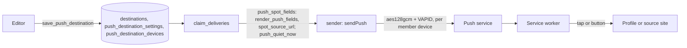

Everything that depends on the fields, the clock or the devices happens in SQL, and the sender
stays dumb: `claim_deliveries` keeps its signature and result columns and, for a push
destination, puts the settings row (`push`), whether it is quiet hours (`quiet_now`, once per
destination in the account's time zone) and the unblocked members (`devices`) in the destination
jsonb, and the text built from the picked fields (`push_title`, `push_body`, clipped to 160 and
400 characters), the tap URL (`push_url`) and the source page (`push_source_url`) in the spot
jsonb. The editor's preview (`preview_push_notification`), Send test (`push_test_delivery`, read
by the `send-test` and `api` functions as the service role) and real deliveries go through the
same `push_spot_fields`, so all three show the same text. `format.ts` only shapes what SQL built:
a tag per station (or per spot), the Open profile and Open on {Source} buttons, `silent` and
`renotify`. `send.ts` sends with the destination's `Urgency` and `TTL`, falls back to today's high
and 15 minutes when a row claimed before the migration carries no `push`, and for a "Don't send"
destination in quiet hours makes no request and reports the batch sent. The claim's expiry sweep
uses the destination's TTL, and its unwanted sweep drops a disabled destination's queued rows as
it does a disabled subscription's; the matcher creates none for it in the first place. The legacy
webhook body strips the `push_*` keys.

## Discord destinations

A Discord destination posts to a channel webhook and has its own row in
`discord_destination_settings` (canvas page 8; `docs/superpowers/specs/2026-10-18-discord-destination-design.md`):
a style, `card` or `plain`; for the card, ordered field lists for the title, the details and a
small grid, what the title links to (the callsign profile, the source site or nothing), a named
card color (by source, or one color for every spot) and a footer with source and time; for the
plain line, its field list, bold first field and link preview; shared by both, field labels and
the separator; and the batch window. Fields are `discord_fields()`, push's list without `comment`
(text typed by the spotter), each with push's fixed rendering. A trigger gives every new Discord
destination the defaults (`discord_default_settings()`).

As for push, SQL renders and the sender only shapes. For a Discord row `claim_deliveries` puts
the settings row (`discord`) in the destination jsonb and nine keys from `discord_spot_fields` in
the spot jsonb: `discord_style`, `discord_title` (at most 256 characters), `discord_description`
(4096), `discord_grid` (`[{name, value}]`, values at most 1024), `discord_footer` ("POTA · 17:42
UTC", or null when off), `discord_color` (an integer), `discord_url` (absolute, through
`app_site_url()`, or null), `discord_line` (the plain line, the callsign a masked link to its
profile, at most 190 characters so ten fit Discord's 2000, clipped only inside a value so no cut
opens its bold or link) and `discord_suppress_embeds`. Every value is escaped for Discord markdown
first (`discord_escape`, in `discord_field_values`), since a feed's callsign, spotter or park name
is whatever the upstream sent, and a profile link is made only for a call of letters, digits, `/`
and `-` (`discord_profile_url`). The
editor's preview (`preview_discord_message`), Send test (`discord_test_delivery`, which marks the
footer and the line "Test message from Long Lines") and real deliveries call the same renderer.

`format.ts` (`discordBatches`) builds each message from those keys and never joins or formats a
field. A card spot is one embed (title, description, URL, color, inline grid fields, footer;
no `timestamp`, which Discord would show in the footer row even with the footer off); plain spots are lines of `content`, joined by a newline (a blank line when the
separator is a new line), with `flags: 4` (SUPPRESS_EMBEDS) when SQL says so, so the profile link
does not expand; the card style never sets it, since it would hide the card. Every message
carries `allowed_mentions: {parse: []}`, so nothing pings even if a value looks like a mention.
With `batch_seconds` 0 each spot is its own message; with a window, ten per message. Grouping
past that happens only when a claim's spots would otherwise need more than
`DISCORD_MESSAGES_PER_CLAIM` (5) messages: the group size is `min(10, ceil(spots / 5))`, and the
claim's cap (50) and interval (10 seconds on average) keep a destination within Discord's 30
messages a minute. Cards are packed in order, a new message starting at the group size or where
the next embed would pass Discord's 6,000 characters a message, so only cards of about 600
characters or more make a claim need a sixth message. `sendDiscord` counts `sent` by the spots each message
carried. The batch window itself is the claim's hold above, so the sender never waits or delays
anything. A row claimed without `discord` (before migration `20261018000100` is hosted) gets the
old fixed embed, ten per message, so the sender and the migration ship in either order. The
legacy webhook body strips the `discord_*` keys.

## Webhook destinations

A webhook destination posts signed JSON to the user's own HTTPS URL and has its own row in
`webhook_destination_settings` (canvas page 7; `docs/superpowers/specs/2026-10-18-webhook-destination-design.md`):
an ordered pick of spot fields from `webhook_fields()` (spot id, time, callsign, frequency, mode,
band, source, reference, place name, state, spotter, country, spot URL, comment), the key style,
time format, frequency unit, what to send for a missing value, the batch window, the retry policy
and the pause threshold. A trigger gives every new webhook the defaults
(`webhook_default_settings()`). Up to ten extra headers live in `webhook_destination_headers`,
each a name and a Supabase Vault secret id; the value leaves Vault only inside
`claim_deliveries`, `webhook_test_delivery` and `duplicate_destination`, and clients and the API
see names only.

SQL renders every value: `webhook_spot_fields` turns the spot into ordered `[{key, value}]` pairs
(jsonb objects do not keep key order), and the claim puts them in the spot jsonb as
`webhook_fields`, with the connection's name as `webhook_connection`, and the window and header
values in the destination jsonb as `webhook`. The editor's preview (`preview_webhook_request`,
built with `json` so its text keeps the order) and Send test call the same renderer. `format.ts`
(`webhookRequests`) builds each spot with `Object.fromEntries(pairs)`, so the keys go out in the
picked order, and wraps it as `{delivery_id, connection, spot}`, one request per spot with no
window or `{spots: [...]}` of up to 50 with one. `send.ts` signs each body and sends the fixed
headers, `X-LongLines-Test` on a test, then the extra headers (`webhookExtraHeaders` drops any
name on the reserved list or value outside printable ASCII, a second check after SQL's). A row
claimed without the keys (before migration `20261018000300` is hosted) gets the legacy
`{deliveries}` body, so the sender and the migration ship in either order.

Policy is SQL's. The batch window is the claim's hold (released at 50 ready rows); one request
per spot is capped at 5 a claim (`webhook_claim_max`), which bounds how long a slow receiver holds
a worker. `mark_deliveries_failed` sets a webhook row's next try from its retry policy
(`webhook_retry_delay`: `none` once, `three_10m` after 60, 180 and 360 s, `day` on the old
schedule) and gives an exhausted row a visibility of now, so the next claim's expiry sweep drops
it with `dropped_at` (`webhook_retries_exhausted`, which `ready` also applies). The sender marks
only the rows whose request was made. With `pause_after_failures` set, failures count toward a
pause at most once per `webhook_pause_spacing()` (30 s) and restart after a success; reaching it
sets `enabled = false` and `auto_disabled_at` and makes the destination's whole queue visible
(rows in retry backoff included), and the claim's unwanted sweep then drops all of it with
`dropped_at`, so resuming delivers none of it. `update_destination` turning it back on clears the
pause. The default threshold is null until the web editor ships (its migration makes it 20).

## Local DX cluster destinations

A Local DX cluster destination (`local_cluster`) sends the spots its connections match to one of
the owner's Long Lines Relay computers, which re-serves them on a telnet DX cluster on that
computer so a logging program's bandmap shows them (Phase 2 of the relay; the wire contract is
v2 of `docs/contract.md` in `sonyccd/longlines-relay`). It has no URL. Its row in
`local_cluster_destination_settings` names the relay token (set null when the relay is revoked)
and an ordered pick of comment fields after the mode (`reference`, `source`, `comment`; the
default is the reference). Only the web editor creates one.

- **Transport.** Edge Functions cannot hold a connection open past their wall clock or be pushed
  to, so the sender serves the stream: a second `Deno.serve` on `SENDER_STREAM_PORT`
  (`sender/cluster_stream.ts`, `GET /v2/spots`, Server-Sent Events behind Fly's `http_service`),
  one stream per relay token, authenticated with `authenticate_relay_token` and the
  `spots:read` scope. `relay-api`'s v2 `me` hands the relay its `spots_url`.
- **Presence and drops.** The sender marks the relay connected while its stream is open
  (`set_cluster_stream`, cleared at start and shutdown by `reset_cluster_streams`). The claim
  takes a row only while its relay is connected and caps each relay at 120 a minute across its
  destinations; rows for an offline relay age out after 2 minutes through the expiry sweep, and a
  stream that closed after the claim leaves its rows unattempted. Nothing is ever marked failed,
  so the destination's health never changes; the card says "Relay offline".
- **Rendering.** SQL renders every value (`local_cluster_spot_fields`, the `cluster_*` keys in
  the claim's spot jsonb), the sender maps them to the contract's `spot` event, and the relay
  formats the DXSpider line. `local_cluster_line` renders the same layout for the editor's
  preview only.
- **Loop guard.** A user's own logged contacts never go to their own Local DX cluster, so a
  contact logged in N1MM never comes back to its bandmap as a spot.
- **No web test.** `send-test` cannot reach the relay's socket; the relay's own Send test spot
  covers it.

# Phase 3: stats snapshot

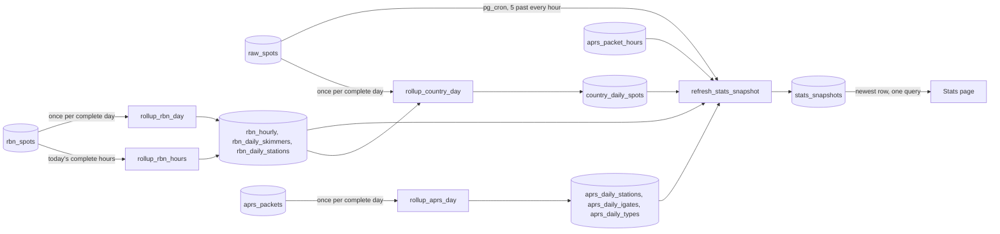

The Stats page is a fixed dashboard of the seven most recent complete UTC days: midnight UTC seven
days ago up to, but not including, midnight UTC today, filtered on `spot_time`. The one exception
is "Spots processed per hour", which is hourly and so ends at the last complete UTC hour: the 168
hours before the refresh. Nothing on the page is adjustable, so the whole page is one precomputed
JSON document.

## Why a snapshot table

The payload is a dozen aggregates over a week of spots (totals, per-day, per-hour and per-band counts, a
per-state choropleth, mode shares, top activators and references, plus activation and chaser
counts beside every spot count). Computing it on every page view
would scan `raw_spots`, which clients cannot read anyway. Instead `refresh_stats_snapshot()`, a
security-definer plpgsql function, builds the payload in one `insert … with … select` and runs
from pg_cron at five past every hour. The web app selects the newest row by `generated_at`, caches
it for the browser session and never polls. The table keeps the 48 most recent rows (two days); the
refresh prunes older ones.

## Counting rules

- Only `pota`, `sotawatch` and `wwff` rows count toward the activity figures (WWFF is a peer of
  POTA and SOTA wherever the page shows them); RBN rows in `raw_spots` are copies of watched
  stations' `rbn_spots` rows and count nowhere. Every such row is one spot. A station spotted by
  two sources (a US park that is both a POTA and a WWFF reference, say) counts twice; callsigns are
  counted exactly as stored (`/P` and the like are kept). A spot is one report, not a contact: a
  busy activation is re-spotted many times, so spot counts run far ahead of operating activity.
- An activation is one distinct (callsign, reference, UTC day), per program. It is an estimate in
  both directions, not a floor on the programs' own numbers: unspotted activations are missing,
  while a callsign stored two ways (`KK4PWJ` and `KK4PWJ/P`) at one park on one day, or an attempt
  that ends short of the QSO minimum, adds one. The totals and both top-8 tables carry it next to
  the spot count.
- A chaser is a distinct spotter callsign, excluding null spotters and self-spots. A self-spot is
  one where spotter and activator share a base callsign: the call with known suffixes (`P`, `M`,
  `MM`, `AM`, `QRP`, `R`, a single digit) dropped, then the longest `/`-separated part, preferring
  a callsign-shaped part on a tie (`base_callsign()`; `is_self_spot()` is the one definition): `SQ1GPR` or `SQ1GPR/M` spotting
  `SQ1GPR/P`, `EA2/G4OBK` spotting itself, `G4OBK/P` spotting `W4/G4OBK`. An RBNHole spot whose
  comment names no skimmer has a null spotter. Skimmers named by RBNHole count as chasers.
- POTA state counts come from `pota_location`, a comma-separated list such as `US-NC,US-VA`; a park
  spanning two states counts once in each. Non-US entries and territories are ignored and all 51
  codes (50 states and DC) are always present, zero-filled.
- SOTA associations are the part of `sota_summit_ref` before the `/`. WWFF national programs
  (`wwffPrograms`, the top 10 by spots) are the part of `wwff_reference` before the `-` (`KFF`,
  `ONFF`, `DLFF`).
- `topActivators` counts WWFF references and activations alongside POTA parks and SOTA summits,
  and `topReferences` has a WWFF arm named from `wwff_reference_name`.
- Bands use a fixed order (`160m` through `2m`); other bands are excluded from the band charts only.
- Modes collapse to CW, SSB (`ssb`, `usb`, `lsb`), FT8/FT4, FM and Other (including null) as
  integer percentages that sum to exactly 100; the rounding remainder goes to the largest bucket.
- Window arithmetic is done on `now() at time zone 'utc'` so a session time zone with DST cannot
  shift the window by an hour.
- `hourly` feeds "Spots processed per hour": the 168 complete UTC hours before the refresh (not
  the day window), zero-filled, each with the POTA, SOTAwatch and WWFF `raw_spots` rows, the
  `rbn_spots` rows whose `spot_time` falls in that hour and the hour's APRS-IS packets from
  `aprs_packet_hours`. The page plots their sum; the "Peak hour" tile figure comes from the same
  series.
  `daily[].rbn` and `daily[].aprs` are the RBN and APRS-IS counts per day.

## RBN figures

`rbn` holds the week's RBN spots, distinct skimmers, spots per band (the same fixed order as the
POTA, SOTA and WWFF bands, so the four charts share an axis; other bands count in spots only) and
the eight most heard stations with how many distinct skimmers heard each. `rbn_spots` takes about 1.5 million rows a day, so the hourly
refresh never aggregates it. `rollup_rbn_day(day)` scans one day once, with grouping sets, into
three small tables: `rbn_hourly` (24 rows a day, zeros included), `rbn_daily_skimmers` (per
skimmer and band) and `rbn_daily_stations` (per callsign). Weekly distinct counts come from the
per-day rows, so they are exact. Skimmers per station cannot be summed from days, so they are
counted from `rbn_spots` (through `rbn_spots_callsign_time_idx`) for the eight stations only and
kept in `rbn_top_stations` until a rollup changes or the window moves. A full day's rollup takes
about 2.5 s; the refresh itself stays well under a second.

The hourly series also needs RBN counts for today's complete hours, which no day rollup covers
yet. `rollup_rbn_hours(from, to)` counts a range of hours into `rbn_hourly` through the
`spot_time`-led unique key of `rbn_spots` (two hours are about 30,000 rows, 25 ms on hosted), and
`rbn_rollup_hours` records when each hour was counted. When the day ends, `rollup_rbn_day`
replaces its 24 rows and the hour markers are deleted.

The refresh rolls up every window day missing from `rbn_rollup_days`, and once more any day rolled
up within an hour of its end, since the inbound worker can hold up to about 50 minutes of lines while
`ingest-rbn` is unreachable. Today's hours follow the same rule through `rbn_rollup_hours`. Rows arriving later than that are not counted. Rollups older than
the window are deleted; the archive keeps every spot.

## APRS-IS figures

`aprs` holds the week's APRS-IS packets, distinct stations (base calls, so SSIDs combine),
distinct igates as sent, and packets for each of the 14 packet types, busiest first. Packets come
from `aprs_packet_hours`, which ingest keeps current. `aprs_packets` keeps only about two days, so
`rollup_aprs_day(day)` saves the rest per UTC day into `aprs_daily_stations`, `aprs_daily_igates`
and `aprs_daily_types`, on the same schedule as the RBN days, including the re-roll an hour after
the day ends. It refuses a day whose rows no longer add up to its `aprs_packet_hours`.
`maintain_aprs_packets()` keeps a day in the Stats window until `aprs_rollup_days` shows a rollup
at least an hour after the day ended. A day older than the window drops without one, so a failing
refresh cannot hold packets forever.

## Spots by country

`countries` feeds the world map: spots per country of the station on the air, for POTA, SOTAwatch,
WWFF, DX Cluster and RBN (APRS-IS packets and beacons are left out). The country is the cty.dat entity that
`cty_lookup()` gives for the call as spotted, so VP2E/K1ABC counts in Anguilla, mapped to ISO
3166-1 alpha-2 by `cty_entity_countries` (England and Scotland are both GB, Alaska is US).
Three entities with no country (Spratly, Scarborough Reef, SMOM) are left out, as is any call
cty.dat cannot place. `rollup_country_day(day)` resolves each distinct call of a day once into
`country_daily_spots`, reading RBN from `rbn_daily_stations`, on the same schedule as the RBN days;
it skips a day while no cty.dat is loaded. The web joins alpha-2 to the atlas's numeric ids
(`web/src/stats/countries.ts`) and names countries with `Intl.DisplayNames`.

The payload's TypeScript shape is `StatsPayload` in `web/src/stats/types.ts`; the pgTAP suite
`supabase/tests/stats_snapshot.test.sql` pins both the shape and the numbers.

# Streaming sources: the inbound worker

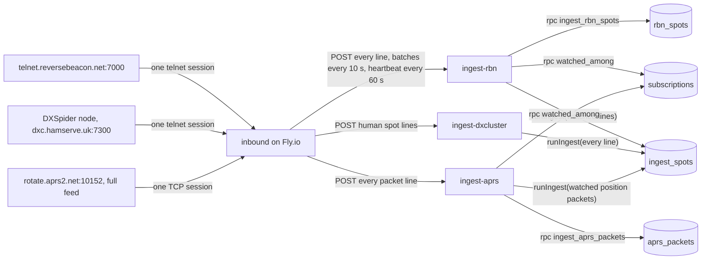

The Reverse Beacon Network only offers a persistent telnet stream. Edge Functions cannot hold one,
and reconnecting every couple of minutes is not acceptable to RBN, so one small process outside
Supabase holds it: `inbound/`, a Deno program on a single Fly.io machine (shared-cpu-1x, 256 MB; it
uses about 20 MB). Issue #13 records the options that were weighed first.

- **Push instead of pull.** `ingest-rbn` runs `runRbnPush` (`_shared/rbn_push.ts`) on each
  batch: it stores every line, then passes the watched ones to the same orchestrator as the pulled
  sources, with `rbnAdapter(body)` wrapping them so `fetchSpots()` returns them; `runIngest` is
  unchanged. The inbound worker never sees a Supabase key: it sends a shared secret in `x-inbound-secret`,
  and the function (with `verify_jwt = false`) compares it with `LONGLINES_INBOUND_SECRET` in
  constant time. Only `POST` is accepted.
- **Everything is stored; watched callsigns are alerted.** The inbound worker forwards every spot line.
  `ingest-rbn` writes each batch to `rbn_spots` (one RPC, `ingest_rbn_spots`), a table
  partitioned by UTC day that keeps seven days in the database; `maintain_rbn_spots()` drops a day
  once every 10-minute slice is archived with a matching count and the callsign rollups have
  recorded it or it is older than 14 days (see "The spot archive"). Only lines whose station `watched_among('rbn', stations)`
  returns (named by an enabled subscription with a destination whose sources are empty or include `rbn`, exactly or by
  base call, the matcher's rule) continue through `runIngest` into `raw_spots` and the matcher, so
  alerting sees a few hundred RBN rows a day.
- **Partitions.** `maintain_rbn_spots()` runs daily at 03:35 UTC and keeps partitions for today and
  three days ahead. Partitions live in the `partitions` schema, which PostgREST does not expose and
  the generated web types do not include. Rows for a day without a partition land in
  `partitions.rbn_spots_default`; `create_rbn_spots_partition` moves them in when it creates that
  day.
- **One parser.** The inbound worker drops non-spot lines with `parseRbnLine` from `_shared/rbn.ts`, the
  same function `ingest-rbn` uses, so the inbound worker and the stored spot cannot disagree about what a
  line is.
- **Dates and ids.** A telnet line has only `HHMMZ`. The adapter takes the instant with that time
  of day closest to the inbound worker's `received_at`. `source_spot_id` is
  `spot_time|spotter|callsign|frequency`; the hash field order is `spot_time, spotter, callsign,
  frequency, mode, snr, speed, type` and must not change.
- **Matching guard.** `spot_matches` lets an RBN spot match only subscriptions that name
  callsigns, so "any source, 20m CW" does not receive other people's watchlist hits. A trigger
  rejects a subscription limited to RBN with no callsigns, since it could never match.
- **Politeness and health.** One connection per feed, reconnect backoff from 30 s (the floor) to
  15 minutes with jitter, reset after a session that lasted five minutes. No data for five minutes
  counts as a dead connection. The inbound worker pushes at least once a minute, even an empty batch, so
  `ingest_state.last_success_at` shows whether it is alive; the Sources page treats RBN as delayed
  after three minutes without one. `:8080/healthz` reports per-feed status for `fly checks list`.
- **More feeds.** `inbound/feeds.ts` is a list. A new telnet stream (RBN FT8 on 7001, say) is a new
  entry plus a source adapter and an `ingest-<source>` function built with `servePush`.
  `_shared/inbound_lines.ts` holds what the pushed sources share: the request body and the `HHMMZ`
  dating.
- **Not only telnet.** The inbound worker also runs the weekly FCC license load and the weekly POTA, SOTA
  and WWFF reference list load, because the files are too big for an Edge Function (see
  "Licenses (FCC)" and "Reference catalog").

## DX Cluster

The second feed is a DXSpider node, by default G1FEF-2 (`dxc.hamserve.uk:7300`, overridable with
`DXCLUSTER_HOST`/`DXCLUSTER_PORT`), which allows read access without registration. The inbound worker logs
in with `INBOUND_LOGIN_CALL` and forwards every line `parseDxLine` (`_shared/dxcluster.ts`) accepts.

- **Straight to raw_spots.** Human spots are a few hundred an hour (a capture on 2026-10-12 saw
  about seven a minute), so there is no firehose table: `ingest-dxcluster` runs `runIngest` over
  the whole batch, like a pulled source, and the archive takes `dxcluster` from `raw_spots` in
  hourly slices.
- **Opt-in matching.** `source_matches`, the sources rule `spot_matches` uses, lets a DX Cluster
  spot match only subscriptions whose `sources` lists `dxcluster`. An empty sources list keeps
  meaning what it meant before the source existed, so existing "any source, 20m" subscriptions
  are not flooded with DX spots.
- **Mode.** A cluster line has no mode field. `resolveDxMode` (`_shared/modes.ts`) takes a mode
  named in the comment (CW, SSB, FT8, ...; FM and AM are not read from comments, where "fm" usually
  means "from"), else the band plan: FT8/FT4 dial windows, then the IARU CW and phone segments.
  Elsewhere, such as 60m, the digital sub-bands and VHF, the mode stays null. USB and LSB are stored
  as `ssb`.
- **Not spots.** Skimmer lines (a `-#` spotter, or an RBN-style `[mode] NN dB NN WPM` comment)
  that a node relays are dropped; RBN covers them. So are `WWV`, `WCY` and `To ALL` broadcasts.
  DXSpider ends each spot line with two BEL characters, which the parser strips. The time is the
  last `HHMMZ` on the line; a locator, state or zones a node appends after it are ignored.
- **Inbound image.** The Dockerfile's `--allow-env` names every variable the inbound worker reads, including
  `DXCLUSTER_HOST`/`DXCLUSTER_PORT`; a test fails when the inbound worker reads one the image does not allow.
- **Ids.** As with RBN, the line has only `HHMMZ`; `source_spot_id` is
  `spot_time|spotter|callsign|frequency`, and the hash covers the comment too, so a re-spot with a
  new comment in the same minute is stored.
- **Quiet hours.** Human spots can pause for minutes, so this feed reconnects after 15 minutes
  without data (RBN: 5) and `/healthz` marks it unhealthy after 20 (RBN: 10).

## APRS-IS

The third feed is the APRS-IS full feed: port 10152 on `rotate.aprs2.net` (overridable with
`APRS_HOST`/`APRS_PORT`), every packet the network carries with no server-side filter. The full
feed is deliberate; never add a filter to the login. It runs at roughly 50-150 packets a second,
4-13 million a day.

- **Off until configured.** `aprsFeed` returns no feed until `APRS_LOGIN_CALL` is set. APRS-IS
  drops an older connection that logs in with the same call-SSID, so the inbound worker's login must be one
  no other client uses (`aprsLoginCall` checks the shape: at most nine characters).
- **Plain TCP.** APRS-IS is not telnet: `TcpLineDecoder` (`inbound/telnet.ts`) decodes UTF-8 and has
  no IAC handling. There is no prompt; the server sends a `# aprsc ...` banner line, and the inbound worker
  answers with `user <call> pass -1 vers LongLines 0.1` (passcode -1 is receive-only). Servers send a
  `#` keepalive about every 20 s, so the feed reconnects after 2 minutes of silence and `/healthz`
  marks it unhealthy after 5. The forwarder buffers up to 150,000 lines (about 25 minutes).
- **Every packet stored.** `ingest-aprs` runs `runAprsPush` (`_shared/aprs.ts`): every line
  `parseAprsLine` accepts goes to `aprs_packets` through `ingest_aprs_packets`, unparseable lines
  to `ingest_failures`, and `ingest_state` records the batch. Stats reads its own per-day rollups
  of packets (see "APRS-IS figures").
- **Watched stations become spots** (since `20261031000100`; the design's amendment of
  2026-10-31). As with RBN, only packets whose source call `watched_among('aprs', calls)` returns
  continue through `runIngest` (`inboundAdapter("aprs", ...)`) into `raw_spots` and the matcher,
  so `aprs` in `raw_spots` is the watched subset while `ingest_state`, `ingest_health`, the
  archive and Stats keep meaning packets. Only `position`, `mic_e`, `object` and `item` packets
  become spots; other types, a `source_call` that is not a plausible callsign (`MYANET`,
  `WINLINK`) and a packet more than five minutes old are skips. The spot's callsign is the
  upper-cased `source_call` (an object's own name stays in the comment), its spotter the igate
  for `qAR`, `qAr`, `qAO` and `qAo` (null for `qAC`, `qAS` and the rest, which name servers), its
  comment the info field as received (positions are not decoded), its time `received_at`, and
  frequency, band, mode, mode family and every reference are null (`raw_spots.frequency_khz` is
  nullable for this source only).
- **One spot per station per 15 minutes.** A station beacons every 30 s to a few minutes, so the
  dedup key is a time bucket: `received_at` floored to `APRS_SPOT_BUCKET_MS` (15 minutes),
  `source_spot_id` `<callsign>|<bucket>` and the hash fields `callsign, bucket`. The first packet
  in a window becomes the spot and the rest hit `ON CONFLICT DO NOTHING`. Neither the window nor
  the hash order may change; either would make every spot look new.
- **Matching.** APRS-IS is opt-in in `source_matches` (an empty "any source" list never includes
  it), and like RBN an APRS-IS spot passes only an AND group that names stations
  (`rules_name_stations`); the `subscriptions_rbn_needs_callsign` trigger refuses a connection
  whose sources are only `rbn` / `aprs` without such a rule. An APRS-IS spot has no band, mode,
  frequency or reference, so those rules' `is`, `contains`, `gt` and `lt` forms never pass it and
  their `is_not` and `not_contains` forms always do; only callsign and group rules tell APRS-IS
  spots apart. `match_pending_spots` never sends one to a `local_cluster`
  destination (no frequency). Push and the sender label it `APRS-IS`; it has no `spot_source_url`.
- **Kept out of reads.** `spot_stream` (so profiles, callsign rollups and group statistics), the
  band map, the country rollup, reference profiles, `recent_spots` and callsign groups' on-air
  check leave APRS-IS rows out; `preview_subscription` and `home_flow` include them. APRS-IS rows
  in `raw_spots` are not archived from there; the packets' archive covers them.
- **What is parsed.** The header (source, destination, digipeater path, the q-construct the
  server added and the igate after it) and the packet type from the data type identifier
  (`position`, `mic_e`, `object`, `item`, `message`, `status`, `weather`, `telemetry`, `nmea`,
  `third_party`, `capabilities`, `query`, `user_defined`, `other`). Positions, weather and
  telemetry are not decoded; the line is stored exactly as received for that.
- **Storage.** `aprs_packets` is partitioned by UTC day on `received_at` (packets mostly carry no
  time of their own), like `rbn_spots`: partitions in the `partitions` schema, created by
  `create_aprs_packets_partition` from `maintain_aprs_packets()` (daily, 03:45 UTC). Dedup is
  `unique (received_at, line_md5)`, so a retried batch inserts nothing. `aprs_packet_hours` keeps
  packets per hour indefinitely; the Sources page reads its 24-hour figure there instead of
  counting millions of rows.
- **Two days.** `maintain_aprs_packets()` drops a day once it is two days old and every
  five-minute slice is archived with a matching count and, while the day is in the Stats window,
  its Stats rollup is final, so the database holds yesterday and today (about 5 GB at 8 million packets a day).

# WWFF

World Wide Flora & Fauna is a POTA-like award program for nature reserves, each identified by a
reference such as `KFF-5268` (spec `docs/superpowers/specs/2026-10-15-wwff-design.md`). It is a
pulled source: pg_cron calls `ingest-wwff` once a minute, which fetches
`https://spots.wwff.co/static/spots.json` (the latest spot per activator over about a day) and
runs it through `runIngest` into `raw_spots`, exactly like POTA. There is no inbound change and no
firehose table.

- **Adapter.** `_shared/wwff.ts`. `source_spot_id` is the upstream `id`; `spot_time` is Unix
  seconds. Skips follow POTA (`too_old` after five minutes, `test_comment`), and QRT spots are kept.
  The reference and its name go into `raw_spots.wwff_reference` and `wwff_reference_name`; the
  reference's latitude and longitude stay in `raw_payload`.
- **Opt-in matching.** As with DX Cluster, `source_matches` lets a WWFF spot match only
  subscriptions whose `sources` lists `wwff`: an empty sources list means
  `source not in ('dxcluster', 'wwff')`. About half of WWFF spots are US `KFF` references that are
  usually POTA activations too, and there is no cross-source dedup, so "any source" subscribers
  would otherwise get duplicate alerts.
- **Reference rule.** "Park, summit, or location contains" (`rule_matches`) also searches
  `wwff_reference`, so `KFF-` matches WWFF spots.
- **Elsewhere.** WWFF is a peer of POTA and SOTA on Stats and profiles (`program` `'WWFF'` in
  `spot_stream`), is archived hourly from `raw_spots`, and stays off the band map.

# WWBOTA

Worldwide Bunkers on the Air is an award program for portable operation from bunkers, each
identified by a reference such as `B/G-2114` (`B/<scheme>-<four digits>`; spec
`docs/superpowers/specs/2026-10-26-wwbota-design.md`). It is a pulled source like WWFF: pg_cron
calls `ingest-wwbota` once a minute, which fetches `https://api.wwbota.net/spots/` (the spots of
the last hour) and runs it through `runIngest` into `raw_spots`. There is no inbound change and no
firehose table.

- **Adapter.** `_shared/wwbota.ts`. The public spot has no id, so `source_spot_id` is `time` as
  received (unique to the microsecond, and the event id of WWBOTA's own SSE stream). `freq` is
  MHz. Skips: `too_old` after five minutes, `test_comment`, and `not_normal` for a `Test` spot or
  a QRT spot without a frequency; other QRT spots are kept. One spot can name several bunkers (an
  "n-fer"): every reference goes into `raw_spots.wwbota_references` (`text[]`, uppercased, in the
  feed's order) and the first bunker's name into `wwbota_reference_name`. Positions stay in
  `raw_payload`.
- **Opt-in matching.** `source_matches` lets a WWBOTA spot match only subscriptions whose
  `sources` lists `wwbota`: an empty list means `source not in ('dxcluster', 'wwff', 'wwbota')`.
  Bunker activations are often POTA or WWFF activations too (`B/G-2114 POTA GB-0051`).
- **Reference rule.** "Park, summit, or location contains" searches every bunker of the spot
  (`array_to_string(wwbota_references, ',')`), so a rule naming the third bunker of an n-fer matches;
  the exact `reference is` compares every element of `wwbota_references`.
- **Rendering.** `render_push_field('reference')` is the bunkers joined with ", " and
  `place_name` the first bunker's name, for push, Discord and webhooks alike. There is no source
  URL: WWBOTA has no public page per bunker. The Discord card color is gold.
- **Elsewhere.** `spot_stream` has a `'WWBOTA'` program arm that credits an n-fer's first bunker,
  so profiles pick it up; `group_statistics_at` names its programs, so it gains
  `kpis.activations.wwbota` and `kpis.places.bunkers`. It is archived hourly from `raw_spots`, with the
  references as one comma-joined string. Stats gains only `daily[].wwbota` and `hourly[].wwbota`
  (for the catalog's rates), from their own CTEs like DX Cluster's `dx`; WWBOTA is not a Stats
  peer and stays off the band map.

# IOTA

Islands on the Air is an award program for island groups, each identified by a reference such as
`EU-005` (spec `docs/superpowers/specs/2026-10-27-iota-design.md`). It has no spot feed, so it is a
tag on DX Cluster spots, not a source: a spot is stored once, as `dxcluster`.

- **Extraction.** `_shared/iota.ts` `iotaReference` takes the first `(AF|AN|AS|EU|NA|OC|SA)-\d{3}`
  in the comment between non-word characters, case-insensitive, as Spothole does; the DX Cluster
  adapter puts it in `raw_spots.iota_reference`. Only the dash form counts. The content hash is
  unchanged (the comment was already hashed).
- **Names.** `import-iota` (pg_cron, 04:25 UTC on the 1st, service role) loads iota-world.org's
  `groups.json` (about 1,200 groups) into `iota_groups` through `load_iota_groups`, refusing fewer
  than 1,000. `ingest_spots` copies the group's name into `iota_reference_name` as it stores a spot.
- **Matching.** The `island` rule field (`is` / `is_not`) takes references or continents (`EU`
  matches every `EU-` reference); a spot without an island passes `is_not`. The reference rule
  searches `iota_reference` too. DX Cluster stays opt-in, so a connection lists `dxcluster`.
- **Elsewhere.** Delivery renders `reference` / `place_name` from the IOTA columns after the other
  programs'; `spot_stream` has an `'IOTA'` arm, so profiles and group statistics (`iota`,
  `islands`) count it; the Stats snapshot has `daily[].iota` / `hourly[].iota` for the catalog's
  rates; `list_recent_spots('iota')` returns DX Cluster spots that name an island. The catalog's
  IOTA entry has `via: "dxcluster"`: never a connection source, its health is DX Cluster's.

# Logged contacts

Long Lines Relay (`sonyccd/longlines-relay`) is a desktop app that catches the contact broadcasts
a logging program sends (N1MM Logger+ format) and posts each logged contact (spec
`docs/superpowers/specs/2026-10-28-logged-contacts-design.md`; the wire contract is
`docs/contract.md` in the relay repo). It is a source, `logged`, with no cron job and no inbound
side: contacts arrive when someone logs.

- **Shape.** `_shared/logged.ts` checks one item of a request (invalid, `clock_skew` more than five
  minutes ahead, `too_old` for an upsert more than 30 minutes old) and builds the spot: `spotter`
  is mycall as logged, `callsign` the worked call, the band from the frequency, the mode through
  `resolveMode`, `source_spot_id` `<user id>|<external id>`, the hash over mycall, call,
  frequency, band, mode and time.
- **Applying.** `apply_logged_contacts(user, items)` applies a request in order, in one
  transaction, keyed by `logged_contacts (user_id, external_id)`: created, unchanged, updated,
  retracted, unknown, or rejected for an upsert whose mycall's base call is not the account
  callsign's, or is but another account has held it longer (`callsign_since`) (`mycall_mismatch`). It stores through `ingest_spots`, so the matcher picks the spot
  up as usual.
- **Retraction.** `raw_spots` stays append-only. An edit retracts the old spot and stores a new
  one; a delete retracts the spot. `raw_spots.retracted_at` is the marker, set and cleared only by
  `apply_logged_contacts`; content a contact had before revives its own retracted row. Every
  reader leaves a retracted row out: `spot_stream` (so profiles, rollups and group statistics),
  `recent_spots`, `preview_subscription`, callsign groups' on-air check, `match_pending_spots`
  and the Stats counts. A delivery made before the retraction is not recalled; a day already
  rolled up keeps its counts.
- **The relay API.** `relay-api` (`_shared/handlers/relay_api.ts`) serves the contract's v1 and
  v2 side by side, the same four routes in each (`device/start`, `device/token`, `me`,
  `contacts`), behind one Vercel rewrite per version on `api.longlines.io`. It only routes,
  checks shapes and maps errors; pairing, token and contact policy are SQL's. v1 answers exactly
  as in phase 1. v2 pairing passes the scopes asked for (`contacts:write`, `spots:read`; both by
  default) and the platform to `start_relay_pairing`'s four-argument overload, and v2 `me` reads
  `relay_account(user, token)` and adds `spots_url` (`LONGLINES_SPOTS_URL`, by default the local
  sender's `http://127.0.0.1:8081/v2/spots`), the sender's spots stream, which is never under
  this function.
- **Elsewhere.** Opt-in matching like WWFF and WWBOTA (`source_matches`); "Logged contacts" in
  push, Discord and webhooks; archived hourly with a `retracted_at` column; Stats has only
  `daily[].logged` / `hourly[].logged`; not on `/health` and never delayed in the catalog.

# The spot archive

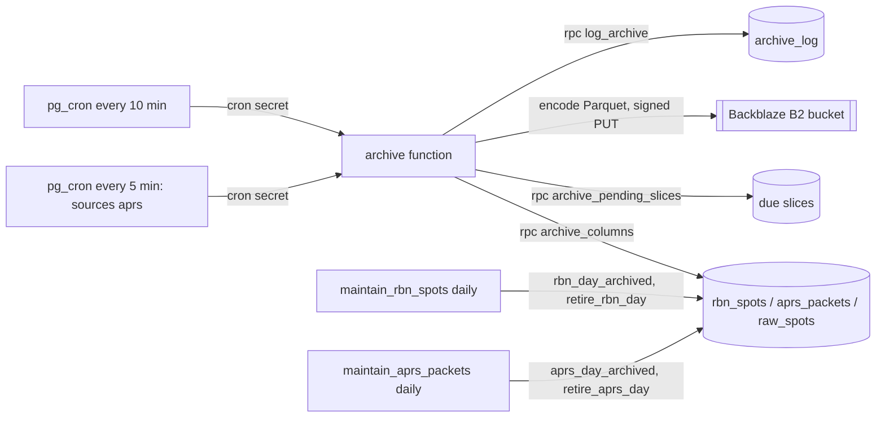

Every spot of every source is kept for analytics as Parquet in a private Backblaze B2 bucket
(specs `docs/superpowers/specs/2026-10-11-rbn-firehose-archive-design.md` with its measurement
amendment, `docs/superpowers/specs/2026-10-14-archive-parquet-design.md` and
`docs/superpowers/specs/2026-10-14-archive-b2-design.md`). Slices archived
before 2026-10-14 are gzipped NDJSON at `<source>/YYYY/MM/DD/HHMM.ndjson.gz` until the one-off
`convert-archive` function rewrites them (issue #174; `_shared/archive_convert.ts`, RPCs
`archive_ndjson_slices` and `archive_repoint_slice` in `20261021000700`): it decodes each object,
checks its rows against `archive_log.row_count`, writes the Parquet the live archive would write
(same `encodeParquet`, same `objectPath`), repoints the log row, and only then deletes the NDJSON
object.

- **Slices.** APRS-IS is archived in 5-minute slices, RBN in 10-minute slices, POTA, SOTAwatch,
  DX Cluster, WWFF and WWBOTA hourly. The length lives only in `archive_slice_minutes(source)`; slices are aligned with `date_bin` and half-open
  (`[start, end)`). Objects are one Parquet file per slice, in Hive-style day folders under the
  source: `<source>/year=YYYY/month=MM/day=DD/HHMM.parquet` (UTC slice start), so readers get
  `year`, `month` and `day` as columns and skip folders a filter rules out.
- **Postgres does the heavy lifting.** `archive_pending_slices` returns the slices that ended two
  hours ago and are not logged, starting at midnight UTC of the first spot's day; `archive_columns`
  returns a slice as one JSON object of column arrays in row order, timestamps as epoch
  milliseconds. The function only encodes Parquet (`hyparquet-writer`, snappy, one row group a
  file; column types in `ARCHIVE_SCHEMAS`) and uploads, which measured at about 0.25 s for a full
  60,000-row run against the 2 s CPU limit.
- **Runs.** pg_cron calls `archive` every 10 minutes with the cron secret (Vault), like the
  ingest jobs. A run takes POTA, then SOTAwatch, then DX Cluster, then WWFF, then WWBOTA, then RBN
  (`ARCHIVE_ORDER`), oldest first, and starts no new slice once it has archived 60,000 rows, so a backlog clears about six times faster
  than real time without risking the CPU limit. APRS-IS is not in that list: at ~100 packets a
  second it alone fills the budget. A second job, `archive-aprs`, calls `archive` every five
  minutes (two minutes off the 10-minute grid) with `{"sources": ["aprs"]}`; two 30,000-packet
  slices a run measured at about 0.2 s, and a backlog clears at about twice real time. The
  function answers 400 to a body naming an unknown source.
- **The bucket.** Uploads are one SigV4-signed S3 `PutObject` each (`_shared/s3.ts`, WebCrypto,
  no dependency; tests pin AWS's published signatures), path-style to the endpoint and bucket in
  the `LONGLINES_ARCHIVE_S3_*` function secrets (`_shared/archive_store.ts`). Hosted, that is B2
  with a key restricted to the bucket and `writeFiles`; locally, the stack's Storage S3 endpoint
  and its `archive` bucket stand in. Missing secrets make a run answer 500 before it reads a
  slice. The old Supabase Storage bucket was copied over once (`docs/OPERATIONS.md`).
- **Logged only when stored.** A slice gets its `archive_log` row (count, bytes, path) only after
  the upload succeeds; a failure leaves it pending for the next run. Empty slices are logged with
  `row_count = 0` and no object, so a gap in `archive_log` always means "not archived".
- **Columns.** Timestamps are `TIMESTAMP(MILLIS)` adjusted to UTC, `frequency_khz` is `DOUBLE`,
  `snr` and `speed` are `INT32`, `raw_payload` is JSON text, the rest are strings. RBN: `spot_time, received_at, spotter, callsign, frequency_khz, band, mode,
  mode_family, snr, speed, speed_unit, spot_type, line`. POTA, SOTAwatch, DX Cluster, WWFF and
  WWBOTA: every `raw_spots` column except `id`, including the upstream `raw_payload`, with
  `wwbota_references` as one string joined with `,`; files written before WWFF shipped lack
  `wwff_reference` and `wwff_reference_name`, and files written before WWBOTA lack its two columns,
  which readers treat as null. Watched
  RBN and APRS-IS rows in `raw_spots` are not archived from there. APRS-IS: `received_at, source_call, destination, path,
  q_construct, igate, packet_type, line`.
- **Retention.** `maintain_rbn_spots()` (03:35 UTC, off the archive's 10-minute grid) retires RBN
  days older than seven that `callsign_rollup_days` records (callsign profiles keep per-station
  totals from every day), and any archived day older than 14 so a missing rollup cannot stop
  retention: `rbn_day_archived` checks every eligible day first (it also clears mismatched log
  rows), then `retire_rbn_day`
  drops the archived ones last, so the exclusive lock a partition drop takes is held only briefly
  and gives up after 5 s. The day's partition and any default-partition rows go only when all
  144 slices are logged with the database's count (`rbn_day_slices`). A mismatched slice loses its
  log row, so the next run re-archives it and the day is retried the next night. `raw_spots` is
  never pruned. `maintain_aprs_packets()` (03:45 UTC) does the same for `aprs_packets` with 288
  five-minute slices a day, retiring a day once it is two days old; nothing rolls APRS up, so there
  is no rollup condition.

# Countries (cty.dat)

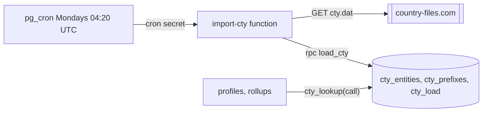

Callsign profiles say which countries and continents a station is heard from, by the spotter's
call. The table behind that is AD1C's cty.dat, the country file loggers use
(spec `docs/superpowers/specs/2026-10-12-callsign-lookup-design.md`).

- **Import.** `import-cty` downloads the file weekly, `_shared/cty.ts` parses it, and `load_cty`
  replaces all three tables in one transaction. A reader sees the old set or the new one. A file
  that does not parse, or has fewer than 300 entities, is refused, and the loaded set stays.
  `cty_load` records the file's version (`=VERyyyymmdd`) and the counts.
- **DXCC, not WAE.** Entities whose primary prefix starts with `*` (Sicily, European Turkey,
  Shetland, ...) are DARC WAE entities. They are not loaded, so their calls fall through to the
  DXCC country (`IT9` to Italy).
- **Lookup.** `cty_lookup(call)` is the only place a call becomes an entity, continent and zones.
  It drops an SSID or skimmer marker (`K3PA-1`, `DK9IP-#`). The location is one of the call's
  `/` parts. Call-area digits are ignored, and so are `/P`, `/M`, `/QRP`, `/QRPP`, `/R`, `/A`, `/B`
  and `/LH` after the first part; written first they are prefixes (`M/DL1ABC` is England). Of the
  rest, a part that is itself a cty.dat prefix wins (`KA1A/VP2E`, `K1A/KH6`), then a part ending
  in a digit (`W4/G4OBK`, `KK4PWJ/VE3`), then the shorter one. It does not use
  `base_callsign()`, which breaks length ties by position. An exact `=` entry for the call or the
  location wins over the longest matching prefix. `/MM` and `/AM` have no country.
- **Access.** The tables are service-role only, like the other internal tables. The rollups read
  them through `cty_lookup`; profiles will read them through definer RPCs.

# Callsign rollups

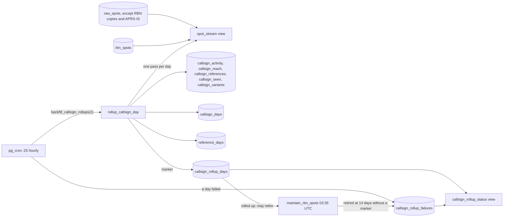

Callsign profiles cover every day since Long Lines started, but `rbn_spots` keeps only seven. The
rollups keep per-station counts and breakdowns forever, never per-spotter rows (specs
`docs/superpowers/specs/2026-10-12-callsign-lookup-design.md` and
`docs/superpowers/specs/2026-10-19-callsign-days-design.md`).

- **`spot_stream`.** One row shape for every source: `source`, `spot_time`, `callsign`,
  `base_callsign`, `spotter`, `spotter_base`, `frequency_khz`, `band`, `mode`, `mode_bucket`,
  `snr`, `program`, `reference`, `reference_name`, `reference_location`, `comment`
  (`raw_spots.comment`, null for RBN). `program` is `POTA`,
  `SOTA`, `WWFF`, `WWBOTA` or `IOTA`, and `reference` and `reference_name` fall back to the WWFF
  columns, then the first WWBOTA bunker, then the IOTA reference, after the POTA and SOTA columns. It is `raw_spots` without its RBN rows
  (copies) and its APRS-IS rows (watched beacons, `source not in ('rbn', 'aprs')`) plus `rbn_spots`. A source that writes `raw_spots` appears with no change;
  a new firehose table needs one `union all` arm. The base columns are computed per row for
  `rbn_spots`, so a query over many RBN rows groups by `callsign` first. Service-role only.
- **`mode_bucket(mode, mode_family)`.** The Stats chart buckets (CW, SSB, FT8/FT4, FM, Other).
  CW follows `mode_family`, so SQL still never derives a family.
- **Tables.** `callsign_activity` (period, base, role, source, band, mode bucket: spots and
  spots per UTC hour), `callsign_reach` (period, base, source, spotter country and continent),
  `callsign_references` (base, program, reference: days, spots, first and last day, latest name),
  `callsign_seen` (base: first and last spot, the last one's frequency and mode, days on the air)
  and `callsign_variants` (base, spelling: spots, last day). Role `heard` is the station spotted;
  role `spotter` is the station spotting others. Self-spots count as heard but not as spotter
  or reach. Countries come from `cty_lookup`, once per distinct spotter.
- **`callsign_days`.** One row per base callsign, UTC day and source: `spots`, and the distinct
  `modes` and `bands` heard as sorted `text[]` (a spot with a null mode or band counts in `spots`
  and adds nothing to the arrays). Heard role only; spotters stay in `callsign_activity`. Modes are
  the canonical values `_shared/modes.ts` stored (`usb` and `lsb` stay as spelled; a reader that
  wants one SSB figure groups them, and there is no SQL grouping function until a consumer needs
  one), so a new mode needs no schema change. Day grain forever: `compact_callsign_rollups()`
  never touches it. Primary key `(base, day, source)` and no other index; both target queries
  ("every day X was active", "X per day this year by source") are prefix scans of it. About 150 B
  a row, one per (base, source) a day, so no partitioning.
- **`reference_days`.** The activations of reference profiles (spec
  `docs/superpowers/specs/2026-10-26-reference-profiles-design.md`): one row per program, reference,
  UTC day, activator base call and source, with `spots` and sorted `modes` and `bands` exactly as
  `callsign_days` has them. `program` is lower case (`pota`, `sota`, `wwff`, as `reference_catalog`
  and `/ref/<program>`), `reference` upper case, as the catalog stores it. Only the POTA, SOTAwatch
  and WWFF sources write it: WWBOTA spots name an array of bunkers and wait for their own source work,
  and RBN and DX Cluster spots carry no reference. Heard role only, every activator stored (hidden
  calls too; the reader leaves them out). Day grain forever, no running totals, never compacted.
  Primary key `(program, reference, day, base, source)` and an index on `(base, day)`; a few
  thousand rows a day. `raw_spots_reference_time_idx`, on `raw_spots` by `spot_stream`'s
  `reference` expression (`coalesce(pota_reference, sota_summit_ref, wwff_reference,
  wwbota_references[1], iota_reference)`) and `spot_time` where it is not null, serves the live read of the days
  not rolled up yet, which goes through `spot_stream` like every profile read; the view's
  expression and the index change together.
- **Exactly once.** `rollup_callsign_day(day)` inserts the day's `callsign_rollup_days` marker
  first and does nothing when it is already there: references, seen and variants are running
  totals and would double. `callsign_days` is filled by one more data-modifying CTE of the same
  statement, from the same grouped pass (every grouped row is a heard row, so summing it by base
  and source counts each spot once), so it inherits exactly once; its insert keeps a row already
  there (a day rebuilt from the archive before it was marked). `reference_days` is one more CTE
  over the same rows, `on conflict do nothing` likewise. The marker also records what the
  day counted (`spots`), whether the archive holds RBN rows of the day the roll-up did not count
  (`without_rbn`: RBN spots counted < RBN rows archived, the whole day after `(day, true)` or a
  late line or two of a retired day; the archive's total is read before the pass, so a slice
  logged during it cannot set the flag) and when its `callsign_days` rows were written
  (`days_filled_at`) and its `reference_days` rows (`references_filled_at`). Right after the
  marker, in the same transaction, the day's `callsign_rollup_failures` row is deleted.
- **Limits.** A day is rolled up from two hours after it ends (`last_rollup_day()`), covering the
  inbound's ~50 min buffer; a spot that arrives after that is not counted anywhere. An upstream edit
  of a spot (same `source_spot_id`, new `content_hash`) is a new `raw_spots` row and counts again,
  as on the Stats page; a re-poll of an unchanged spot inserts nothing.
- **Whole days or none.** A day is refused, and retried on the next run, while no cty.dat is
  loaded (its reach would stay empty) or once its RBN rows were archived and retired (retention
  stops waiting at 14 days). Retired is `rbn_day_retired(day)`: some RBN slice of the day is
  logged in `archive_log` with more rows than `rbn_spots` holds for it (the per-slice test
  `rbn_day_archived` uses, as index range probes per logged slice). Only retention removes rows, so late lines in the
  default partition cannot hide a retired day unless they refill every logged slice, and a day the
  archive has nothing for is not retired. `rollup_callsign_day(day,
  true)` rolls up such a day without RBN when an operator accepts the gap, marking it
  `without_rbn`.
- **One pass.** A day is grouped once by call, spotter, band, mode, hour and reference; base calls
  and countries are resolved per distinct call afterwards. A synthetic 1.5M-row RBN day takes about
  13 s locally.
- **Hourly.** The `rollup-callsign-days` cron job runs `backfill_callsign_rollups(2)` at 25 past
  every hour: at most two days without a marker, oldest first, each in its own subtransaction;
  only when it rolled none up, `backfill_callsign_days` for at most two days (below), and only when
  that filled none either, `backfill_reference_days` for at most two, so a run never makes more than
  two day passes over the firehose (a statement-timeout cancel is not caught and would undo the
  whole run; a `reference_days` pass reads one day's POTA, SOTA and WWFF `raw_spots`, about 20 ms a
  seeded day locally); then it folds day rows older than 35 days into month rows
  (`compact_callsign_rollups`). A failed day does not count toward the two
  and is retried next hour. Yesterday is rolled up at 02:25 UTC, ahead of RBN retention at 03:35.
  The job is separate from `maintain_rbn_spots()` on purpose: a slow or cancelled rollup never
  holds that job's partition locks or undoes its retention, and retention still retires an RBN
  day 14 days old without its rollup. The first day to consider is `first_rollup_day()`: the
  earlier of the first marker and the first `raw_spots` row with `source <> 'rbn'`, both cheap, so a spot day before the
  first marker is still rolled up; `spot_stream` is scanned for it only while there is neither,
  since `rbn_spots` has no leading `spot_time` index.
- **Filling history.** Days rolled up before `callsign_days` existed have `days_filled_at` null.
  `fill_callsign_days(day)` (locking the marker row, so two fills cannot both insert) reads the
  day once from `spot_stream`, grouped by call, source, mode and band. Every source but RBN is
  inserted from that pass, exact: `raw_spots` is never pruned. The RBN row is too while the day is
  not retired and the pass holds at least the RBN spots the roll-up counted (`callsign_activity`'s
  RBN heard day rows), late rows included. Otherwise (retired, or fewer than counted) the RBN row
  comes from those day rows: `spots` and `bands` exact, `modes` at most `cw`. Only the CW bucket
  maps back to a mode: RBN reports no FM, and the SSB, FT8/FT4 and Other buckets hold several
  modes. A day is refused (only the archive has it) when it is retired, not `without_rbn`, has no
  day rows left and has RBN heard month rows for its month: compacted before the fill. The fill
  also sets `without_rbn` for a day rolled up with `(day, true)` before the column existed (the
  migration set it already where the day rows were still there) and deletes the day's failures
  row. `backfill_callsign_days(n)` runs it oldest first, each day in its own subtransaction, from
  hourly runs that rolled no day up (23 of 24), before compaction, and
  records a failure as `callsign_days fill: ...`; `compact_callsign_rollups` keeps a day's
  `callsign_activity` and `callsign_reach` rows until `days_filled_at` is set, so the approximate
  source cannot vanish first. New days are filled by the roll-up itself and never take this path.
  `reference_days` has its own fill: `fill_reference_days(day)` (locking the marker row too) builds a
  marked day with `references_filled_at` null from `raw_spots` (`source in ('pota', 'sotawatch',
  'wwff')`), which is exact for every day, writes the roll-up's rows (pgTAP compares the two), sets
  `references_filled_at` and deletes the day's failures row only when it is its own, as
  `fill_callsign_days` does with `callsign_days fill: ` rows since the same migration, so neither
  fill's success clears the other's failure (the one row holds whichever failed last).
  `backfill_reference_days(n)` takes days that never failed first, oldest first, at most `n` filled
  and `2n` attempts, and records a failure as `reference_days fill: ...`.
- **Status.** A day that fails in the hourly job lands in `callsign_rollup_failures` (`attempts`,
  first and last failure, `last_error`) through `record_callsign_rollup_failure`, written in the
  exception handler after the day's subtransaction rolled back. `rollup_callsign_day` deletes the
  row when the day succeeds, from the job or by hand (`(day, true)` included). `maintain_rbn_spots()`
  records a day it retires at 14 days without a marker the same way (`RBN rows retired before the
  roll-up ran`), when the day did not already read as retired and the archive logged RBN rows for
  the day, both decided before any partition is dropped (its state, not whether a partition existed: a day that only ever
  lived in the default partition is recorded too), so the gap is visible within hours instead of
  a warning in the logs; deleting late rows of a day retired earlier records nothing. `callsign_rollup_status` is one row per UTC day from
  `first_rollup_day()` to `last_rollup_day()`, with `status` decided in this order: `fill_failed`
  (marker, `days_filled_at` or `references_filled_at` null, a failures row; `last_error`'s prefix
  says which fill), `done_without_rbn`, `done`, `rbn_retired` (no
  marker and `rbn_day_retired`, the test `rollup_callsign_day` and the fill use), `failed`,
  `pending`; yesterday enters the view at 02:00 UTC and is `pending` until the 02:25 run.
  `rbn_retired` wins over `failed` because such a day also gains a failures row every
  hour from the refusal. The cron body stays `select count(*) from backfill_callsign_rollups(2)`:
  raising from it would roll back the successful days, so the failures table is the signal.
  Service-role only, like the tables.

# Licenses (FCC)

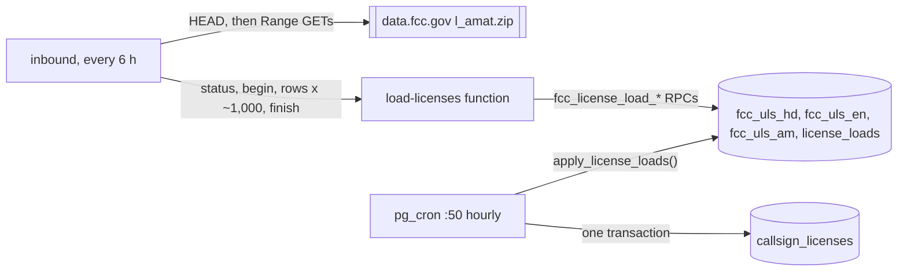

Profiles show a station's license (spec `docs/superpowers/specs/2026-10-12-callsign-lookup-design.md`).
`callsign_licenses` holds one row per callsign with an `authority` column, so other countries'
registries can load into it later; FCC is the only loader for now.

- **Where it runs.** The FCC publishes the full amateur file, `l_amat.zip`, every Sunday: about
  200 MB, of which the three files used are 160 MB compressed and 525 MB inflated, about 1.7M
  records each. An Edge Function cannot stream that within its limits, so the inbound worker does
  (`inbound/licenses.ts`). Every six hours it HEADs the file. An inbound worker whose functions URL is local
  does not load licenses unless `INBOUND_LICENSES` names a file. When the `Last-Modified` is not already
  ready or applied (`fcc_license_load_status`), it loads it; a load that did not finish is retried
  after twelve hours, so a load that keeps failing downloads the file twice a day at most.
- **Streaming.** `inbound/zip.ts` reads the zip's central directory from its tail, then fetches only
  `HD.dat`, `EN.dat` and `AM.dat` with Range requests and inflates them with
  `DecompressionStream`. Every range carries `If-Range` with the strong ETag HEAD saw (else its `Last-Modified`;
  a weak-only validator is refused), and each body must match its `Content-Range` and each entry its
  CRC-32, so a
  file the FCC replaces mid-load comes back as a 200, which is refused, rather than as a mix of
  two weeks' bytes. Memory stays flat (a full run against the real file parsed all three in
  13 s before network time and stayed under the inbound worker's 160 MB heap); an inflated size that differs from the directory's is
  an error, which catches a truncated download.
- **Parsing.** `_shared/uls.ts` turns records into rows: HD gives call, status and dates, EN the
  licensee's name and state, AM the operator class. Codes become labels (`Amateur Extra`,
  `Active`). A field with a line break in it is joined back onto its record. Nothing else leaves
  the parser: no street address, city, ZIP, PO box, phone, email or FRN. The staging tables have no
  columns for them either, and `jsonb_to_recordset` drops any such key.
- **Staging.** The files are not sorted by system identifier, so the inbound worker cannot join them in
  memory. It pushes 5,000 rows per request to `load-licenses` (inbound secret, `verify_jwt =
  false`), which stages them in unlogged tables keyed by system identifier. A retried batch is
  skipped by `on conflict do nothing`. Each `rows` call answers the file's running total, kept in
  `license_loads.counts` in the same transaction, so a batch retried after a lost reply is not
  counted twice or lost. `finish` compares those totals with the tables and marks the load
  `ready`. Fewer than 500,000 records in any file is refused first. When the inbound worker gives up (a
  short file, a batch that keeps failing, a shutdown) it calls `abandon`, which fails the load
  with the reason and empties staging at once.
- **The swap.** Replacing about 1.5M rows takes longer than the API's 8 s statement timeout, so the
  swap is not an RPC. `apply_license_loads()` runs from pg_cron at :50 every hour. It is a no-op
  unless a load is ready. It deletes the FCC rows and inserts the joined staging set in one
  transaction, so a reader sees the old set or the new one. When a call has several records (a
  call reissued after it lapsed), the active one wins, then the latest grant. If staging no longer
  matches the recorded counts (unlogged tables are emptied by a crash) or the insert fails, the
  load is marked `failed` and the old set stays.
- **Access.** Service-role only, like `license_loads`, the staging tables and the RPCs. The data
  is public FCC data, but a direct read would show the license of a call in `hidden_callsigns`,
  so clients get licenses only through `callsign_profile()` (the `callsign-profile` function).
  `20261012000050` granted `select` to `anon` and `authenticated`; `20261012000070` revokes it.

# Reference catalog

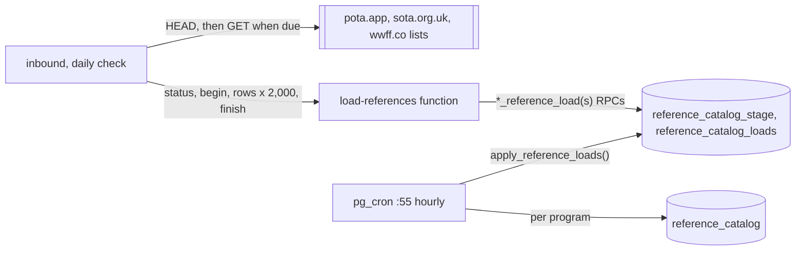

Reference pages name a park, summit or WWFF reference from its program's own list (spec
`docs/superpowers/specs/2026-10-26-reference-profiles-design.md`, decisions 2 and 3).
`reference_catalog` holds one narrow row per reference, keyed `(program, reference)` with the
reference upper case: name, active, location, region, country, coordinates, grid, SOTA's altitude
and points, and the valid dates. No raw upstream row is kept.

- **Where it runs.** The three lists are 10 to 25 MB of CSV (POTA `all_parks_ext.csv`, SOTA
  `summitslist.csv`, WWFF `wwff_directory.csv`), too much to parse in one Edge Function request,
  so the inbound worker loads them (`inbound/catalogs.ts`), the way it loads the FCC licenses. Once a day it
  HEADs each list with its User-Agent. A program's list is downloaded when its last applied load
  began at least seven days ago (its start, not `applied_at`, which the hourly swap puts after the
  seventh daily check) and the file's `Last-Modified` is newer (`reference_load_status`);
  POTA's file changes daily, so the week is what keeps it to one download per program a week. One
  program at a time, so at most one download is open. A version whose newest load was refused,
  finished or applied is never downloaded again, and a load that did not finish is retried after
  twelve hours. An inbound worker whose functions URL is local loads nothing unless `INBOUND_CATALOGS=on`.
- **Parsing.** `_shared/reference_catalog.ts` is a streaming CSV reader with no dependency and the
  per-program column mapping (spec "Schema > Catalog"). Columns are found by header name, never
  position; SOTA's title line before its header is skipped. An empty value or `-` is null,
  coordinates of 0, 0 are none, and SOTA's grid is derived from its coordinates at the length
  POTA's file uses. A row whose reference is not letters and digits joined by `/` or `-` is
  counted as a skip. WWFF's region is its `state` only when that names a subdivision (`K-PA`, not
  `R` or `K-???`), else its `region`; its grid drops dashes and spaces around the locator and cuts
  an extended one to six characters. Each record's length counts its separators, so a run of empty
  fields fails the load instead of growing without bound.
- **WWFF countries.** The directory leaves `country` blank for about 80% of its references, so
  `stage_reference_rows` takes cty.dat's entity for the row's `dxcc` prefix (`cty_lookup` once per
  distinct plain prefix in the batch; `AN`, WWFF's Antarctica, is looked up as `CE9`) and the
  directory's `country` only when that finds none. The parser passes `dxcc`; it is not stored.
- **Staging.** The inbound worker posts 2,000 rows per request to `load-references` (inbound secret,
  `verify_jwt = false`; the function accepts up to 5,000). `begin_reference_load` abandons the
  program's open loads. `stage_reference_rows` skips a reference already staged in the load and
  answers the load's running total, kept on the load row in the same transaction, so a batch
  retried after a lost reply is neither counted twice nor lost; the inbound worker passes the last total to
  `finish_reference_load`. When the inbound worker gives up (a failed batch, a short read, a shutdown) it
  calls `abandon`, which deletes the staged rows at once. The stage is a logged table, unlike the
  license staging, so a crash between finish and apply does not empty it.
- **A truncated list never replaces a good one.** `finish_reference_load` refuses a load whose
  stage differs from the inbound worker's count or holds fewer rows than `reference_load_floor(program)`:
  90% of the program's current rows, or 10,000 on a first load. The refusal is committed by that
  call (it does not raise) and its staged rows go.
- **The swap.** `apply_reference_loads()` runs from pg_cron at :55. Per program, in its own
  subtransaction, it takes the newest finished load newer than the last applied one, checks the
  count and the floor again, deletes the program's rows and inserts the stage set-based, so a
  reader sees the old list or the new one. SOTA's ~180,000 rows take a few seconds, which fits
  the cron session but not the API's 8 s statement timeout, so the swap is not an RPC. When a run
  neither swaps nor refuses anything while some program's newest load is refused, it raises, so
  `/health`'s Scheduled jobs card shows the job failing until a good load lands. A run that refused
  a load itself commits instead: raising would roll that refusal back and leave the load
  `finished`, which the inbound worker waits on, for as long as the other program stays refused.
- **Access.** Service-role only: the three tables (RLS on, no policies) and every RPC. Clients
  read the catalog only through the reference profile ("Reference profiles").

# Callsign profiles

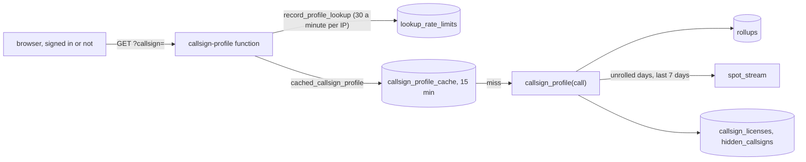

A profile is everything Long Lines has heard from one station, for a public page (spec
`docs/superpowers/specs/2026-10-12-callsign-lookup-design.md`).

- **One RPC.** `callsign_profile(call)` returns the whole page as jsonb. Its shape is
  `CallsignProfile` in `web/src/profile/types.ts`, pinned by
  `supabase/tests/callsign_profile.test.sql`. It is security definer and not granted to clients.
  SQL reduces the call to its base (`KK4PWJ/P` is `KK4PWJ`'s profile); TypeScript only checks
  that the input looks like a callsign.
- **Rollups plus the live edge.** All-time figures come from the rollups. Days of the last 14
  without a `callsign_rollup_days` marker (today, yesterday until 02:25 UTC, a failed day) are
  read from `spot_stream` and added in, with the same rules: self-spots count as heard but not in
  reach. The test checks that a day reads the same live as rolled up. "Heard by" (top 10) and
  "Recent spots" (newest 25) always read the last 7 days live. Hunting comes from the rollups
  only, since reading it live would need a spotter index on every source.
- **The `rbn_spots` index.** `(base_callsign(callsign), spot_time)`, built per partition and
  attached to a parent index so the build blocks inserts only for today's partition. It stores
  `base_callsign()` output, so a migration that changes that function must reindex it.
- **One read of a station.** The RPC reads `spot_stream` once, through `raw_spots`'
  `(base_callsign, spot_time)` index and `rbn_spots`' `(base_callsign(callsign), spot_time)`
  expression index, and groups spotters before resolving their base calls and countries. It reads
  the unrolled days in full, the week grouped by spotter and the week's newest 25, never the whole
  week's rows. Against 1.5M-row RBN days locally, a profile builds in about 70 ms for a station
  with 5,000 RBN spots a day (about 220 ms right after a restart) and about 200 ms for one with
  20,000.
- **Not heard and hidden.** `heard` is null for a station never spotted that never spotted
  anyone. A call in `hidden_callsigns` (operator-managed, base calls) gets that shape with no
  license, and skips the cache, so hiding takes effect at once.
- **The function.** `callsign-profile` (`_shared/handlers/callsign_profile.ts`) is public: `verify_jwt = false`,
  no caller check, so it must never import `isServiceRole` (a test fails if any
  `verify_jwt = false` function reaches it). It returns 400 for input that cannot be a callsign
  (TypeScript checks the shape; SQL returns null when the input has no base call, like `P/1`),
  counts each lookup against a one-minute window per client and returns 429 with "Too many
  lookups. Try again in a minute." past 30. The client is the address from a header the edge proxy
  sets (`LONGLINES_CLIENT_IP_HEADER`, `cf-connecting-ip` by default; the last entry if it holds a
  list), else the last `x-forwarded-for` entry, never the first, which the client writes. A value
  that is not an IP address counts as missing, and the first fallback in an isolate logs a warning.
  An IPv6 client counts by its /64, since one host usually holds the whole prefix. It is stored as an
  HMAC keyed with the service-role key (imported once per isolate), so the table cannot be reversed
  by hashing every IPv4 address. Profiles are
  cached in the database for 15 minutes and sent with `Cache-Control: public, max-age=300`.
  `prune_callsign_lookups()` clears finished windows and expired entries hourly at :15.

# Reference profiles

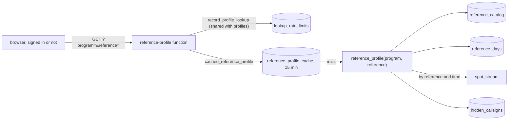

A reference profile is the public page of one POTA park, SOTA summit or WWFF reference,
`/ref/<program>/<reference>` (spec `docs/superpowers/specs/2026-10-26-reference-profiles-design.md`).

- **One RPC.** `reference_profile(program, reference)` returns the whole page as jsonb: the
  catalog header, totals, first and last activation, the year heat map, monthly activations,
  bands, modes, top activators, recent activations and the week's newest 25 spots. Its shape is
  `ReferenceProfile` in `web/src/references/types.ts`, read by the function's Zod schema and pinned
  by `supabase/tests/reference_profile.test.sql`. It is security definer and not granted to
  clients.
- **Activations.** One activator (base call) at the reference on one UTC day. Rolled-up days come
  from `reference_days`; the days of the last 14 without a `callsign_rollup_days` marker (never
  before the first marker) are read live from `spot_stream`, and each day is read from one side
  only. The live read is the program's POTA, SOTAwatch or WWFF spots at the reference, through
  `raw_spots_reference_time_idx` (RBN's arm has no reference and drops out of the plan); about
  4 to 13 ms on the seeded database.
- **Per-spot figures.** `reference_days` keeps only distinct modes and bands per activator and
  day, so the bands chart, the mode shares, the calls as most recently spotted and who was spotted
  first come from the same index read over all time (`raw_spots` is never pruned), counting only
  the spots of the activations counted above, so the mode spots add up to the spot total.
  `spot_stream` carries `comment` for the recent spots.
- **Hidden calls.** An activator in `hidden_callsigns` counts in no list and no total, a spot by a
  hidden spotter stays out of the recent spots, and a cache row built before the newest
  `hidden_at` is a miss, so hiding takes effect at once.
- **Not found.** Null, and a 404 "Reference not found.", for a program without a list, a
  malformed reference (letters, digits, `/` and `-`, at most 64) or one in neither the catalog nor
  any visible spot. A spotted reference outside the list gets a page without its header.
- **The function.** `reference-profile` (`_shared/handlers/reference_profile.ts`) works like
  `callsign-profile`: `verify_jwt = false`, never imports `isServiceRole`, refuses malformed input
  before any database call, shares `lookupLimit` (one budget with profiles and group pages), never
  logs a reference, and sends `Cache-Control: public, max-age=300` on a 200. A failed RPC or a
  reply outside the schema is a 500 "Reference pages are unavailable right now."
- **Links.** `referencePath` (`web/src/references/paths.ts`) builds every link to a reference page,
  only for POTA, SOTA and WWFF: the callsign profile's places, Stats' most spotted references,
  group statistics' places and the band map's crowd menu. "Get alerts" opens
  `/connections/new?source=&reference=`, which prefills an exact `reference is` rule.
- **The exact reference rule.** `reference is` / `is_not` (beside `contains` / `not_contains`)
  compare upper-cased values with each of a spot's references (POTA, SOTA, WWFF, every WWBOTA
  bunker, IOTA) for equality, so `US-1000` never matches `US-10000`; `contains` stays for partial
  text such as `US-NC`. Exact values are validated in `normalize_subscription_rules` (trimmed,
  upper-cased, at most 64 characters of letters, digits, `/` and `-`, so a comma-joined list is
  refused) and matched in `rule_matches`.

## Reference lookup

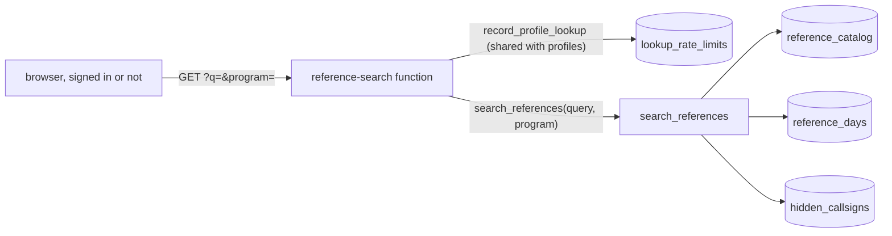

`/ref` finds a POTA park, SOTA summit or WWFF reference by its reference or its name, and the
reference rule's picker suggests list entries from the same function (decisions 11 and 14 of the
spec).

- **One RPC.** `search_references(query, program)` (`20261027001500`) returns up to 25 list rows
  and `more`. A search is every whitespace-separated word of the trimmed query, upper-cased, found
  with `strpos` in the reference or the upper-cased name (never `like`, so `%` and `_` are
  literal); 2 to 64 characters and at most 6 words, else null. A null program searches all three.
  It reads only the catalog and `reference_days` (no live days). Activations are distinct
  (base, day) pairs without hidden calls; retired rows and rows never activated are kept; the order
  is activations, then reference. Its shape is `ReferenceSearch` in `web/src/references/types.ts`,
  pinned by `supabase/tests/reference_search.test.sql`. Each row's header comes from
  `reference_catalog_header(row)`, the same object `reference_profile` builds as `catalog` (pgTAP
  compares the two), without latitude, longitude and validFrom.
- **No new index.** The catalog (about 350,000 rows) is scanned once into a materialized CTE
  (`offset 0` keeps the upper-cased text built once a row, not once a word). The activations then
  come one of two ways, whichever reads less: with few matches, each counts its own range of
  `reference_days`' primary key (about 9 us a match); with many, one grouped pass over the whole
  primary key, in its order, is joined to the matches (about 0.4 us a row). `search_references`
  switches once the matches pass a twentieth of `reference_days`' `reltuples`, where the two cost
  about the same; `search_references_at(query, program, grouped_from)` is the body, and pgTAP runs
  both ways and requires the same payload. A query can match the whole catalog: every POTA, SOTA
  and WWFF reference holds a `-`, so `- -` (3 characters, 2 words) is a valid search for every row.
  Measured on the real lists (350,553 rows) with 2,000,000 synthetic `reference_days` rows (90,000
  references activated) after a vacuum: `mitchell` 0.2 s, `us` (25,000 matches) 0.4 s, `an`
  (63,000) 0.8 s, `e a` (210,000) 0.9 s, and `- -` or `-0` (every row) 1.0 to 1.1 s, the worst
  case. One probe a match had cost 3.8 s for `- -`. The worst case grows with `reference_days`, at
  about 0.4 s a million rows, so at about 15,000,000 rows it would near the 8 s statement timeout;
  a per-reference summary maintained by the roll-up is the step after that.
- **The function.** `reference-search` (`_shared/handlers/reference_search.ts`) works like
  `reference-profile`: `verify_jwt = false`, never imports `isServiceRole`, refuses a bad query or
  program with a 400 before any database call, shares `lookupLimit`, never logs a query, and sends
  `Cache-Control: public, max-age=300` on a 200. A failed RPC or a reply outside the schema is a
  500 "Reference search is unavailable right now."
- **The page.** `/ref` keeps `q` and `program` in the query string, makes one request per
  submitted search, and with no query lists the Stats snapshot's most spotted references without
  a request. `/ref/<program>/` with no reference redirects to `/ref`.
- **The picker.** With `is` / `is_not`, the reference rule's values field searches as the user
  types (300 ms debounce, at least 2 characters, answers cached for the editor's lifetime, a stale
  answer never shown) in the one program among the sources or all three, and still accepts any
  typed reference.

## Management API

Scripts manage destinations, subscriptions and callsign groups through the `api` Edge Function with
a personal API token instead of a browser session (`docs/openapi.yaml` is the public reference and `docs/API.md` its guide;
migration `20261013000300_management_api.sql`). Public URL `https://api.longlines.io/v1/...`, a
host-matched rewrite in `web/vercel.json` to `/functions/v1/api/v1/...`.

- **Tokens.** `api_tokens` stores a SHA-256 of each token (`ll_live_` + 52 base32 characters, 260
  random bits, so no slow hash) plus its first 12 characters for display. `create_api_token` and
  `rotate_api_token` return the plaintext once, like `create_destination`'s signing secret.
  `token_hash` is left out of the column grant. Rotation keeps the row and restarts the expiry
  window. Revoking is a plain delete (own rows, RLS). Ten tokens per user.
- **A request.** The function (`verify_jwt = false`, since the token isn't a JWT) routes the path
  first (`_shared/api/routes.ts`), so an unknown path costs no database call. It then hashes the
  bearer token and calls `authenticate_api_request`, which finds an unexpired token, touches
  `last_used_at` at most once a minute and counts the request in `api_rate_limits`. That table
  holds one row per token: each new minute deletes the token's older rows, so no cron prunes it.
  Over 60 a minute is 429. A write route with a read token is 403.
- **Acting as the user.** `api_call(token_id, op, args)` is the only way in. It checks the token
  and the op's scope again, sets `request.jwt.claim.sub` and `request.jwt.claims` to the owner for
  the transaction, and calls the same RPCs the web app calls (`save_subscription`,
  `create_destination`, `save_callsign_group`, ...). `auth.uid()` inside them is the owner, so
  ownership checks, validation and messages are shared with the web app and can't drift. The
  claims are put back before it returns. A few operations the web app doesn't have yet live next to
  it as ordinary `auth.uid()` RPCs, executable only through `api_call`: `update_destination`,
  `delete_destination`, `patch_subscription` (merges the patch into the stored subscription and
  saves through `save_subscription`), `edit_subscription_callsigns` (one atomic update), and
  `patch_callsign_group` / `edit_group_callsigns`, which lock the group, merge the change and save
  the whole list through `save_callsign_group`, so normalization to base calls and the 1,000-call
  cap stay the web app's.
- **Errors.** SQL raises user-facing messages. `_shared/api/errors.ts` maps "... not found." to
  404, "Remove it from its subscriptions first." to 409, other raised messages and Postgres data
  and integrity errors to 400, and everything else to a logged 500.

# Band map

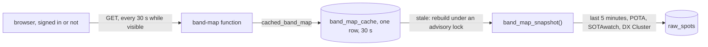

`/band-map` shows who is on the air now: one strip per band, frequency across, one lane per
source. It is public, like Stats and profiles.

- **One shared result.** Every visitor polls, so nobody's request queries `raw_spots` directly.
  `band_map_snapshot()` builds the payload, and `band_map_cache` holds it in one row.
  `cached_band_map()` serves that row while it is under 30 seconds old. Once it is older, the
  function takes a transaction-scoped advisory lock, checks again, rebuilds and upserts. Requests
  that arrive together wait for the first one's commit and then serve its row, so a crowd costs
  at most one `band_map_snapshot()` every 30 seconds. There is no cron job: an idle site rebuilds
  nothing. The payload goes out with `Cache-Control: public, max-age=15`.
- **What shows.** POTA, SOTAwatch and DX Cluster spots only. RBN is a skimmer firehose that would
  bury the human spots (RBN still shows on profiles), and APRS-IS beacons have no frequency. WWFF
  is left out for now, though it is a peer of POTA and SOTA on Stats; adding it (a lane, a color,
  `band_map_snapshot`'s source list) is a separate product call. A
  station appears once per band, at its latest spot there, keyed by `base_callsign`, so
  `KK4PWJ/P` and `KK4PWJ` are one dot. Hidden calls never show. `raw_payload` never leaves the
  table. The shape is `BandMapPayload` in `web/src/bandmap/types.ts`, pinned by
  `supabase/tests/band_map.test.sql`.
- **The index.** The window reads `raw_spots_spot_time_idx`. Five minutes is a few hundred rows
  at most, so the source filter runs on those rows and needs no index of its own.
- **The function.** `band-map` (`_shared/handlers/band_map.ts`) is `verify_jwt = false` with no
  caller check, so it must never import `isServiceRole`. It has no rate limit: a request is one
  read of a one-row table.
- **The page.** Each band is a MUI X `ScatterChart`. The x axis is frequency, and y is a fixed
  lane per source: DX Cluster at the bottom, POTA in the middle, SOTA on top. Segment edges are
  `ChartsReferenceLine`s. The band plan (`web/src/lib/bandplan.ts`) is for display only. A click
  takes the nearest dot through the chart's Voronoi handler. A station alone within the crowd
  tolerance (band width / 140, or / 45 on a phone) opens `/call/<base>`. When it isn't alone, a
  menu lists everyone there. The source chips filter in the browser and never refetch.

# Callsign groups

A group is a named list of up to 1,000 callsigns, such as a club roster, that subscriptions use in
place of typed calls (spec `docs/superpowers/specs/2026-10-13-callsign-groups-design.md`).

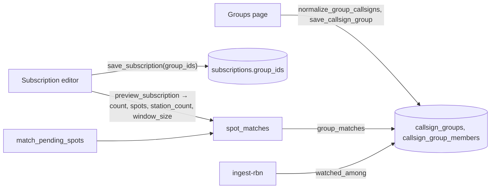

- **Storage.** `callsign_groups` (name unique per account, case-insensitively) and
  `callsign_group_members(group_id, callsign)`, indexed `(callsign, group_id)` for the matcher.
  Members are base calls (`base_callsign()`, a check constraint), so `KK4PWJ` catches `KK4PWJ/P`;
  a group cannot target only `/P`, though a typed callsign still can. Clients read their own rows
  through RLS and write only through `save_callsign_group(payload)`, which validates the name,
  normalises the calls with `normalize_group_callsigns` (the Groups page shows its output, so the
  chips are what will be stored), refuses more than 1,000 and replaces the members by diff in one
  transaction. `list_callsign_groups()` returns every group with its members, counts and
  `on_air` (members spotted in `raw_spots` in the last 30 minutes, and the newest such spot).
- **Subscriptions.** `subscriptions.group_ids uuid[]` is an array rather than a join table, so
  the preview can match an unsaved row built from the dialog, like the other filters.
  `save_subscription` refuses an id the caller doesn't own ("Group not found."), and an update
  without a `group_ids` key keeps the groups. `delete_callsign_group` refuses a group any
  subscription still uses ("Remove it from its subscriptions first."). Edits are live: a changed
  group changes every subscription that names it, with no re-save.
- **Matching.** `spot_matches` checks groups last, through `group_matches(group_ids, base)`, an
  `exists` probe of the member index with the spot's base call, so a call in two groups is one
  match and one delivery. The callsign filter is off only when there are no typed calls and no
  groups; a subscription whose groups are all empty matches nothing, never "any station". An RBN
  spot needs typed calls or a group, and `watched_among` adds group members to the RBN watchlist,
  starting from the member index.
- **Preview.** `preview_subscription` keeps only the caller's own group ids (compared as text,
  so a malformed id is ignored too), so it cannot probe another user's groups. It also returns
  `station_count`, the distinct base calls across the typed calls and those groups' members, which
  the editor shows as "Matches N stations from your groups and callsigns.".
- **The web.** The Groups page (`web/src/groups/`) edits whole lists. The Subscriptions page and
  the editor each load `list_callsign_groups` once per visit, for the group names on each card and
  the editor's "Callsign group" rule. TypeScript never resolves membership or counts stations; both
  come from SQL. If the list fails to load, the cards leave the group rule out, the editor's rule
  can't be edited, and a saved subscription keeps its groups.

## Group statistics

Page 10 of the design canvas; the design is
`docs/superpowers/specs/2026-10-19-group-statistics-design.md`.

- **Building.** `group_statistics_at(group, period, now)` (`20261019000400`) builds one payload for
  the last 7 or 30 UTC days from the members `group_member_bases()` returns (hidden calls left
  out): spots per member and day from `callsign_days` plus the live days from `spot_stream`, as the
  profile's calendar does; bands and mode buckets from day-grain `callsign_activity`; activations
  and places from `spot_stream`'s references; last heard from `callsign_seen`. It runs with
  `plan_cache_mode = force_custom_plan` so the member array stays a constant to the planner (a
  generic plan tested every row against the whole array: 0.8 s became 3.2 s for 1,000 busy
  members).
- **Caching.** `cached_group_statistics` keeps each (group, period) payload in `group_stats_cache`
  for an hour, built single-flight under an advisory lock as `cached_callsign_profile` is. A row
  also stores the roster it counted; a member change, a newly hidden call or a build that raced a
  save makes it a miss. There is no cron job: nobody opening a group costs nothing.
- **Reading.** The owner reads through `get_group_statistics` and the landing cards through
  `list_group_summaries`, which reads the same cached 30-day payload (so card and page agree)
  within a 3 s build budget and reads who is on the air live. The public reads `/g/<code>` through
  the `group-page` Edge Function and `public_group_statistics` (service role), which returns null
  for an unknown or private code and redacts callsigns unless the owner shows them.
- **Sharing.** `callsign_groups.public`, `show_callsigns` and `public_slug` (10 base32
  characters, made the first time the page goes public, kept after) are written only by
  `save_callsign_group`. The management API cannot set them.

## Subscription builder

A subscription is built as one source, a filter and zero or more destinations
(`web/src/subscriptions/`). The picker dialog on `/subscriptions` chooses the source, then
`/subscriptions/new?source=<id>` and `/subscriptions/<id>` are full pages with three steps and a
preview beside them. A source page's Create subscription button goes straight to the editor.

- **Same columns.** The filter's rule rows (Callsign, Callsign group, Band, Mode, and Park,
  summit, or location on POTA, SOTAwatch, WWFF and WWBOTA) each edit one existing column, so a field appears at
  most once and rules always combine with "all": `spot_matches` ANDs the columns and ORs the
  values inside one. Nothing about matching changed.
- **One source** is a web rule: new subscriptions save `sources` with one entry. Older
  subscriptions with several, or none ("any source"), open with their sources listed and keep
  them on save. The API still accepts any list.
- **Zero destinations.** `save_subscription` accepts an empty list (`20261014000300`). Such a
  subscription stays off: `match_pending_spots` and `watched_among` skip it (`20261015000500`),
  so it starts no quiet window and watches no RBN calls. It keeps its `enabled` flag, so it
  starts by itself once a destination is added. The web shows its switch off and disabled, and
  "Waiting for a destination" on its card.
- **Preview window.** `preview_subscription` samples the last 200 spots of the filter's sources
  from the last 24 hours, not of every source, and returns `window_size` so the page can say
  "7 of the last 42 POTA spots would pass". The cards show the same figure for each subscription.
- **RBN** still needs typed calls or a group (the `subscriptions_rbn_needs_callsign` trigger); the
  editor starts an RBN subscription with an empty Callsign rule and keeps Save disabled until it
  has a call or a group.

# Installable app and service worker

The web app is an installable PWA (`web/public/manifest.webmanifest`, icons rendered once from
`favicon.svg` and committed) with a service worker that exists only for push. `web/src/pwa/sw.ts`
is a second build entry emitted unhashed as `/sw.js`, which `vercel.json` serves
`Cache-Control: no-cache`; `register.ts` registers it on load (the TypeScript source as a module
worker in dev). It has three handlers and no `fetch` handler, so it caches nothing and a deploy
can't strand a stale bundle. Their logic is in `sw-handlers.ts`, typed against small interfaces
and tested in node: `push` shows the notification the worker built (title, body, tag, tap URL and
optional actions; the service worker never formats text), `notificationclick` focuses an open
Long Lines window and navigates it, or opens one (a source site always gets its own window), and
`pushsubscriptionchange` re-subscribes with the old key and posts `push-subscription-changed` to
open windows. The worker never holds a session or token, so re-registering the device is the
page's job; when the worker could not re-subscribe, the page subscribes with the app's key. The worker calls `skipWaiting()` at
startup, since there is no cache for a new version to keep consistent, and the build fails if
`sw.js` would import another chunk: it is registered as a classic worker.

The browser side lives in `web/src/pwa/`. `push.ts` is the only module that touches
`PushManager`, `Notification` and `PushSubscription`, behind an injectable `PushEnv` so its tests
run in node: `pushSupport()` reports `unsupported` (no push APIs, or no VAPID public key in the
build), `ios-needs-install` (Safari outside an installed app), `denied`, `off` or `on`;
`enablePush(label)` runs on the user's click with `Notification.requestPermission()` as its first
statement (Safari drops the gesture after an `await`), subscribes with the public key and
registers the device (`register_push_device`, with "{Browser} on {Platform}" from
`deviceAgent()` and whether the app is installed); `disablePush()` unregisters and unsubscribes.
The browser remembers only its own last endpoint, in `localStorage`, and never reads one back
from the database. Three things keep the registration current: `AppProvider` runs
`refreshPushRegistration()` once per load with a session (a granted, subscribed browser re-sends
its keys; a granted one with no subscription but a remembered endpoint the account still lists
subscribes again and moves that device to the new endpoint; a denied one reports its remembered
endpoint blocked), `register.ts` runs it again when
the worker posts `push-subscription-changed`, and every local sign-out passes `pushCleanup` to
`signOut`, so the device leaves with the session ("Sign out other devices" keeps it). Installing
is `install.ts`: `main.tsx` captures Chrome's `beforeinstallprompt` before the first render, the
account menu shows Install app while `installState()` is `prompt` or `ios`, and Safari gets the
Home Screen steps in a dialog since it has no prompt. Push and install share the same copy
source as the editor (the spec's Copy, as amended for page 5).
